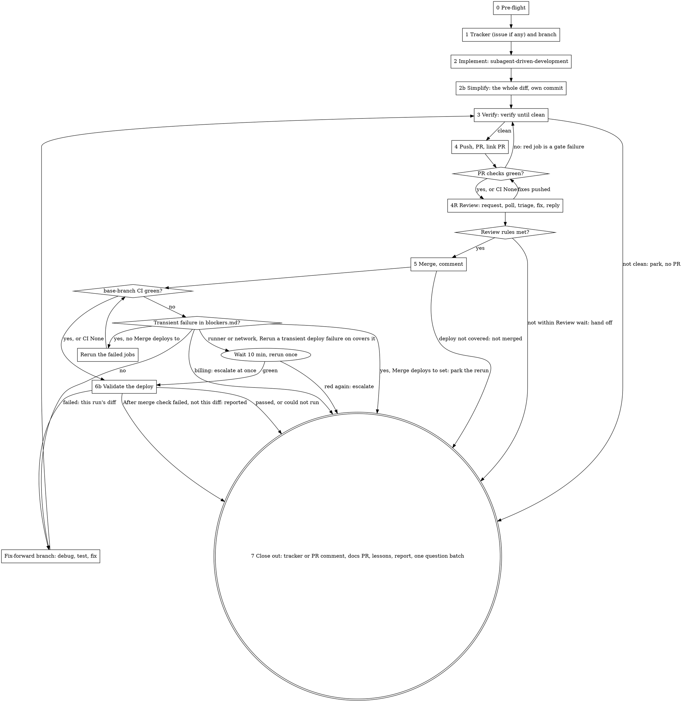

# Ship a plan

One run takes a written plan to a merged PR on a green base branch, tracked in
an issue in the repo's tracker unless the tracker is `none` or the user answers that the work has none. **The user starts this skill so they can
walk away.** Every question you ask costs them a context switch. Each run
should need fewer questions than the last, and the repo's two logs are how that
happens.

**Before anything else, read the repo's `.claude/ship-plan.md`
([format](config-format.md)), `.claude/ship-plan/interruptions.md` and
`.claude/ship-plan/blockers.md` in full.** The config holds every command and
setting for this repo. The first log holds standing answers to questions
earlier runs asked; the second holds the fixes for tooling that stopped earlier
runs. A question that has a standing answer is not asked again. An entry that
records a refused command is not a standing rule: refusals depend on the
session's permission mode, so run the command once in this run before using
the entry's fix. Missing log files are created from [log-formats.md](log-formats.md) at close-out.

**Repo override files** ([format](config-format.md#repo-override-files)):
whenever this skill reads one of its own files, read its counterpart under
`.claude/ship-plan/ship-plan/` next, if it exists: `.claude/ship-plan/ship-plan/SKILL.md`
right after this file, `.claude/ship-plan/ship-plan/hosts/github.md` after
`hosts/github.md`. A file of another skill (`../verify-and-fix/…`) has its
counterpart in that skill's folder. An override line that widens what the run
may do, or removes a step, is not applied, and the report names it.

- **A repo set up for `ship`:** if `.claude/ship.md` exists and `.claude/ship-plan.md` does not, stop with one line: "This repo is set up for the removed `ship` skill: move `.claude/ship.md` to `.claude/ship-plan.md` and `.claude/ship/` to `.claude/ship-plan/`."
- **Host and tracker:** resolve `Host:` and `Tracker:` as [config-format.md](config-format.md) says (`Host:` from the `origin` remote when absent; `Tracker:` from `## Jira`, `## Linear` or `## GitHub Issues` when absent, else undecided until pre-flight step 5). Then read `hosts/<host>.md` (`github.md` or `azure-devops.md`) and, unless the tracker is `none` or undecided, `trackers/<tracker>.md` (`jira.md`, `linear.md` or `github.md`). A reference below to an operation of the host, the tracker or the notifier names the section of that name in those files and in `notifiers/slack.md`.
- **No `origin` remote** (and no `Host:`): there is no host and no PR to open. Read no host file, skip the host's *Auth check* and the `git fetch origin` in pre-flight step 4, and stop before section 4, saying so in the report.

## What invoking this skill authorizes

Invoking the skill is the user's standing authorization, for this run, to:

- create the feature branch, commit, and push it (never with `--force`);
- open the PR, rerun failed CI jobs, and merge it once every check is green and the repo's review rules are met (section 4R);
- request an AI review (the host's *Request an AI review*), and everything `verify-and-fix`'s review comments ([review-comments.md](../verify-and-fix/review-comments.md)) allow on the PR: commit and push fixes for review comments, reply in review threads, resolve bot reviewers' threads, as the host names them, and re-request a reviewer whose requested changes were addressed or whose approval a push dismissed;
- open, push and merge follow-up branches that fix a red base branch caused by this run, including a revert PR;
- in the Slack channel recorded in `## Slack` only, and never in any other channel: post a review request for each PR it opens (section 4R, step 2), reply in that post's thread to ask for a re-review (section 4R, step 3), and add the `pr-merged` reaction to that post (section 5);
- read and write the run's issue — the one found or chosen in pre-flight (section 0, step 5): create it where the user chose, link it to the related issue the user chose, assign it, set its status, append to its description, add comments;
- for each issue the plan's `Tickets:` line lists (section 0, step 5): read it, assign it, set its status as section 1 and section 7, step 1 say, and add comments. Nothing else: no description edit, no link, no other issue;
- open, push and merge the docs branch that a `Docs PR:` line names (section 7, step 2): the spec `ship-issue` kept out of the code PR, and the docs changes the spec lists;
- open, push and merge the docs-only lessons branch (section 8).

It does **not** authorize the following. Each goes into the question batch (section 3), never done on your own:

- a push to the base branch, `--force`, `--admin`, `--no-verify`, disabling a hook or a check;
- approving the PR, dismissing a review, resolving a human reviewer's thread, or requesting a reviewer other than the AI reviewer (code owners are requested by the host);
- everything under the host's *Never*;
- any deploy or production write, except a merge whose base-branch deploy goes only to environments that `## Allowed` `Merge that deploys to:` covers ([config-format.md](config-format.md#-allowed));
- a write to a shared environment's data;
- deleting a branch, file or row you did not create;
- spending money (paid APIs, a paid service);
- editing Claude Code settings files or any skill's `allowed-tools`;
- everything under the config's `## Never do`.

Apart from `## Allowed`, the config can add to this list, never remove from it.

`superpowers:subagent-driven-development` and `verify-and-fix` both say that a push, a
PR or a merge needs the user. Under this skill, the lists above replace that
rule.

**The frontmatter's `allowed-tools` pre-approves these commands** for the turn
that invoked the skill. They only match when written exactly as this skill
and the host file write them:

- **every push names its branch:** `git push origin <branch>`. A bare `git push` is not pre-approved, and on the base branch it would push to it;
- merges: the host's *Merge the PR*, in the form the config's `Merge:` picks;
- reruns: the host's *Rerun a failed PR check*, and the host's *Rerun a base-branch run* where the host pre-approves it;
- reverts: `git revert --no-edit <sha>`;
- fetch, stage and commit (`git fetch origin <ref>`, `git add <files>`, `git commit`) are local and pre-approved. Run a fetch and a merge as two separate commands, never joined with `&&`.

Gate and prerequisite commands from the config are not pre-approved. In a
permission mode that prompts, list them in the pre-flight batch with the exact
allow lines (`Bash(<command>)`) for the user to add, so the run does not stall
on its first gate. Add the allow line the host's *Rerun a base-branch run*
gives, when it gives one.

The pre-approval clears when the user sends a message. So every question you
ask ends with: **"Answer with `/ship-plan <your answers>`,"** which starts the
skill again, renews the pre-approval, and resumes from the ledger. A command
still refused after that goes into the batch (section 5, step 5).

## The run

The run ends at section 7 and nowhere else. Waiting on CI is not an end, and
neither is a pending question when other work remains.

**This session reads little itself.** Every turn re-reads its whole context,
so what it reads stays expensive until the next compaction: one session ran
about 360 `grep`, `sed` and `cat` calls of its own at a median context of
300k tokens. It reads the ledgers, the config, `questions.md`, the plan text of
the task it dispatches, `git status`, `git log`, `git diff --stat`, and the
last 60 lines of a gate or CI log. Anything wider (a source file, `grep` or
`git grep` over the code, a full CI log, any file over 300 lines) goes to an
`Explore` agent at the `## Models` `Research` row (default `sonnet`,
`medium`), whose prompt asks for at most 30 lines with file:line quotes.
`blockers.md` and `interruptions.md` are read in full once per session; after
a compaction, `grep -n` them for the tool or gate at hand.

### The ledger

`.superpowers/ship-plan/<branch>/ledger.md`, with every `/` in the branch name written as `-` (`feature/x` → `feature-x`), so section 0, step 2's `*/ledger.md` listing finds it (`.superpowers/` goes in
`.git/info/exclude`, never `.gitignore`). Its first line is always
`Phase: <n> | Plan: <path> | Issue: <id or none> | PR: #<n> | merge: <sha> | base run: <id>`,
rewritten as each value becomes known; a finished run ends with `Phase: done`. Below it, one line per event: phase
changes, `Ruling:` lines, `Asked:` lines (every question put to the user, with
its answer), questions parked, CI results, `Lesson:` lines, and a `Branch: <name>` line
once the branch exists (section 1), which a resume switches to.
**After a context compaction, resume from this line and `git log`, not from
memory.** `questions.md` sits next to it (section 3). `verify-and-fix` keeps its own
ledger in `.superpowers/verify-and-fix/<branch>/`; link to it rather than copying from it.

**When the session ends before the run does** (a usage limit, the context
running out, a batch the user will answer later): bring the ledger up to date,
then write a handoff: the `handoff` skill when it is available, otherwise a
`HANDOFF.md` next to the ledger. Its resume line is `/ship-plan`, with no
argument: the ledger says where the run stands.

## 0. Pre-flight — see [phase-implement.md](phase-implement.md); read it when this phase starts

## 1. Tracker and branch — see [phase-implement.md](phase-implement.md); read it when this phase starts

## 2. Implement — see [phase-implement.md](phase-implement.md); read it when this phase starts

## 2b. Simplify — see [phase-implement.md](phase-implement.md); read it when this phase starts

## 3. Questions — see [phase-verify.md](phase-verify.md); read it when this phase starts, and whenever a question comes up before it

## 4. Verify, push, PR — see [phase-verify.md](phase-verify.md); read it when this phase starts

## 4R. Review — see [phase-merge.md](phase-merge.md); read it when this phase starts

## 5. Merge — see [phase-merge.md](phase-merge.md); read it when this phase starts

## 6. Base-branch CI — see [phase-merge.md](phase-merge.md); read it when this phase starts

## 6b. Validate the deploy — see [phase-merge.md](phase-merge.md); read it when this phase starts

## 7. Close out — see [phase-close.md](phase-close.md); read it when this phase starts

## 8. Lessons — see [phase-close.md](phase-close.md); read it when this phase starts

## Queued mode (ship-queue)

**A run is queued** when it was started by ship-queue as its child session
(`printenv SHIP_QUEUE_PARENT` prints a parent key; the child ran ship-issue,
which invoked this skill, or ran this skill directly with answers) and that
parent's ship-queue ledger in this checkout
(`.superpowers/ship-queue/<parent>/ledger.md`) has a `Current: <KEY> started …` line
naming this run's issue (its ledger's first-line `Issue:`, or the plan's
`From ship-issue` block before the ledger exists), with no `Result: <KEY>` line
after it. A leftover queue ledger alone does not make a run the user started
queued. Nobody is watching the run. Everything above applies, with these
changes:

- **Several open runs** (section 0, step 2): the queue's other sub-issues can each hold one. Resume the one whose `Issue:` is the `Current:` key; never ask which. When ship-queue passes answers for a run already `Phase: done` with an `Asked: … — pending` line, that done ledger is the one: apply the answers as section 0, step 2 says for a done ledger, even though other runs are open.
- **Outcome line:** at close-out (section 7, step 1), write `Outcome: <Done|Base branch red|Awaiting review|Not merged>`, the outcome whose template the closing comment used, under the first line. ship-queue reads it; `Base branch red` stops the queue.
- **Ask nothing: never `AskUserQuestion`, and never wait for a reply** (section 0, step 10; section 3, step 5; section 7, step 7). The batch goes into `questions.md` and the ledger as unqueued (`Asked: … — pending`), and as one comment: the tracker's *Comment*, or with no issue the host's *PR comment* (no PR either: the ledger only). Number the questions, each with its options and the recommendation first, and end with the answer line **"Answer with `/ship-queue <parent> <KEY>: <your answers>`."** (`<parent>` is the queue ledger's `Parent:`). The queue resumes this run with them in the form `/ship-queue <parent> <KEY>: <answers>`. Carry on with everything the answers do not block, as unqueued; the run then ends at section 7 as it would.
- **Review wait** (section 4R): when the PR's checks are green and only a person's approval, or a person's unresolved thread, is missing, hand off at once (step 5) instead of waiting the `Review wait:` window. The wait for an AI review (at most 20 minutes) and every CI wait stay. The queue polls once more after its last sub-issue.
- **No handoffs of this run's own:** neither the session-end handoff (the ledger section) nor a next part's (section 7, step 3). The queue writes one for the whole queue, and the queue is the next part.
- **Lessons** (section 8): the branch is `docs/ship-plan-lessons-<yyyy-mm-dd>-<KEY-n>`, so a queue's runs on one day do not collide on one branch name. Write `Lessons branch: <name>` when you create it, and `Docs branch: <name>` when docs-pr.md creates the docs branch; the queue reads them to know the branch is its own. The `Lessons PR:` line is written as unqueued. Everything else in section 8 is unchanged.

## Runner mode (ship-runner)

**A run is in Runner mode** when the ship runner started it as a child
(`printenv SHIP_RUNNER` prints the runner's folder) and that folder's
`state.json` has a `current` field naming this run: the run issue's key (its
ledger's first-line `Issue:`, or the plan's `From ship-issue` block before the
ledger exists); with no issue (`Issue: none`) under ship-issue, the slug its
ship-issue ledger's folder is named with (`.superpowers/ship-issue/<slug>/`);
or, for a run the runner started on a plan alone, the plan file's name
without `.md`. A `SHIP_RUNNER` whose `state.json` names another
item, or none, does not make a run a runner child. The runner's prompt names
the phase (`implement`, `verify`, `merge` or `close`) and, for `implement`, a
range of plan tasks. Nobody is watching. Everything in Queued mode above
applies, with these changes:

- **The answer line** of the comment that carries the batch is **"Answer in the session that started the run."**, in place of the `/ship-queue` one. The answers come back in a later runner prompt, after "The user's answers, copied exactly:". Rewrite each answered `Asked: … — pending` line in place with its answer, never as a second line: the runner counts every line that still ends in `— pending`.
- **`Asked:` lines** hold the question, then its options with the recommendation first, as verify-and-fix's Runner mode writes them: `Asked: <the question, its options, the recommendation first> — pending`. The runner's `status` prints them as they are, and the watching session asks from them.
- **Which run** (section 0, steps 2 and 3): the open run whose `Issue:` is the `current` key, or whose `Plan:` is this run's plan, whatever the argument. Never ask which, and never start a second run for a plan that has an open ledger.
- **The run's branch, in every phase, before anything else in it:** when the checkout is on `<base>` and clean and the ship-plan ledger has a `Branch:` line, `git switch <branch>` first (a rerun or the next queue item can leave the checkout on base). If the branch is gone because its PR merged, stay on `<base>`, as section 0, step 2 says.
- **Only the named phase, reading only its phase file:** `implement` is sections 0, 1, 2 and 2b ([phase-implement.md](phase-implement.md)); `verify` is sections 3 and 4 ([phase-verify.md](phase-verify.md)); `merge` is sections 4R, 5, 6 and 6b ([phase-merge.md](phase-merge.md)); `close` is sections 7 and 8 ([phase-close.md](phase-close.md)). Every phase also reads what this skill's opening reads before anything else: `.claude/ship-plan.md`, `.claude/ship-plan/interruptions.md`, `.claude/ship-plan/blockers.md`, `hosts/<host>.md`, `trackers/<tracker>.md`, `notifiers/slack.md` when `## Slack` names a channel, and the override counterparts of each; a later `implement` child reads them only as the `implement` bullet below says. Section 3 also applies whenever a question comes up, as its index line says. A step that sends the run to a section in another phase file (section 4, step 4 to section 4R, steps 1–2; section 5, step 2 back to section 4, step 6) reads that section there, for that step. When the phase's own text sends the run to section 7 early (verify not clean, awaiting review, awaiting merge, not merged), read phase-close.md then and close out as written.
- **A phase ends where the next one begins:** rewrite the `Phase:` field of the ledger's first line to it, keeping its other fields (`Phase: 3` after section 2b, `Phase: 4R` once section 4 reaches section 4R, `Phase: 7` after section 6b), then end. The close phase ends as section 7 says (`Phase: done` when the outcome is Done).
- **`implement` with a task range:** do only those tasks. After each task's review passes, write `Progress: task <n> done`, `<n>` as its `### Task <n>` heading numbers it; a task parked instead (its question goes in the batch and the run goes on without it) gets `Progress: task <n> parked`. The runner counts both lines as handled to pick the next range. The first child runs sections 0 and 1 first. A later child (the ledger is at `Phase: 2`) re-reads exactly: the plan's header and `## Global Constraints`, its own task range, the ship-plan ledger, and `git log <base>..HEAD --oneline` — nothing else before its first task. What section 2 puts in a dispatch (config sections, `## Models` rows, `## Prerequisites`) is read when that dispatch is built. **`implement` with no range** (every task has its `Progress:` line): section 2's steps after the last task, then section 2b. **`implement`, the whole plan** (the plan has no `### Task` headings): sections 0 and 1, all of the plan's work as section 2 does it, section 2's steps after the last task, then section 2b, in this one child.
- **Progress lines:** at each milestone write `Progress: <text>` to the ledger: `task <n> done` (or `parked`), `review round <n>` (each `verify-and-fix` call in section 4, each section 4R round), `PR #<n> opened`, `CI <green|red>` (each time the PR's checks or the base-branch run settle), `merged <sha>`.
- **Blocked:** when nothing in the phase can go on and no question waits for the user (awaiting review or merge after the close-out, a tool that fails on every route), write `Blocked: <reason>` to the ledger.
- **A question before the ledger's folder is known** (section 0, steps 5 and 6): there is no ledger to write it to. End at once, with the question in the `RUNNER:` line as `blocked`.
- **The final reply ends with exactly one line** `RUNNER: <phase-done|waiting|blocked|done> <text>`, and nothing after it: `phase-done` when the ledger's first line has moved to the next phase or the range's tasks are done; `waiting` when an `Asked: … — pending` line waits for the user; `blocked` with the reason of the `Blocked:` line; `done` when the ledger says `Phase: done`.

## Runner or session

With `## Runner` `Mode: runner`, or the argument `--runner`, the ship runner runs the phases and this session only watches and relays: read [runner-session.md](runner-session.md) and follow it with `start plan <path>`. Otherwise ignore this section; the skill runs as above.

## Red flags

| Thought | Reality |
|---|---|
| "I'll ask about the merge / the rerun / the follow-up PR" | The authorization section covers these. Do them, except a merge that deploys where `## Allowed` does not cover it (section 5, step 3), and a rerun of a deploying base-branch run (red-base.md). |
| "Quick question, then I'll carry on" | Park it. Ask the batch when nothing unblocked is left. |
| "I'm fairly sure, but I'll check with the user" | Run the confidence test. If it passes, rule and record. |
| "I'll post the PR to the team channel, it's obviously the right one" | Only the channel in `## Slack` (config or local file). Neither: ask in pre-flight, and `none` means no post. |
| "Move it to In Review" | Use only the statuses the config names. |
| "Checks are green, merge" | Section 4R first: the review rules, the AI review, and every comment handled. |
| "No approval yet, I'll keep waiting" | Wait for `Review wait:`, then hand off. The run must end. |
| "One background loop over the whole review window is simpler" | One `sleep 300` at a time, with a status line after each poll (section 4R, step 3). Through a two-hour loop the user sees nothing and cannot ask. |
| "I'll approve it / resolve their thread so it can merge" | Never. Approval and a person's thread belong to the reviewer. |
| "The AI reviewer is a bot, its comments don't matter" | Grade every comment by what a user would get. A bot can be right. |
| "The reviewer is wrong, I'll ignore it" | Reply with the quoted evidence. Every thread gets an answer. |
| "Approved, and the AI reviewer has one more suggestion: I'll push it" | If stale reviews are dismissed, that push throws the approval away. Reply "follow-up" instead. |
| "The run issue is done, so I'll close its sibling sub-tasks too" | Only the issues the plan's `Tickets:` line lists, each only when its own tasks are committed and a commit carries its key. |
| "The tracker already says done, fine" | Done means the config's `Done means:`. Check the base-branch run first. |
| "The PR is merged, so I'm done" | The run ends when the base branch is green, the closing comment is written, the docs PR is open (when the ledger has a `Docs PR:` line), and lessons are recorded. |
| "The spec can go in with some later docs change" | A held spec reaches the repository only through section 7, step 2. Open the docs PR at close-out. |
| "The base branch failed, probably flaky, rerun until it passes" | Only a failure listed as transient gets a rerun, and at most 3; with `Merge deploys to:`, none, since a rerun redeploys, unless `Rerun a transient deploy failure on:` covers a runner or network failure: then one, after a 10-minute wait, and a second failure escalates. A billing refusal is escalated at once. Anything else gets a root cause. |
| "Push the fix straight to the base branch, it's one line" | Never push to the base branch. A fix branch goes through the same loop. |
| "The ruling is obvious, no need to write it down" | An unrecorded ruling is a decision made in secret. Write the ledger line. |
| "I'll update interruptions.md next time" | Next time is when it would have saved the question. Do it at close-out. |
| "Use a worktree for isolation" | A fresh worktree lacks the repo's untracked files. Use the current checkout; put a busy checkout in the batch. |
| "No issue key, so I'll create one in the config's project" | Ask the "Issue question" first. Where a new issue goes and the related issue are the user's choice. |
| "No tracker here, so I'll just note it in chat" | The PR is the record. Plan, rulings and verification go in its body. |
| "No checks reported, I'll keep waiting" | When the host's *Has CI* finds none, it is CI None. Otherwise 10 minutes, then park. |
| "No checks is not the same as checks passing, so I can't merge" | With CI None, `verify-and-fix` clean is the gate. The repo has no CI to pass; merge and report "base branch has no CI". |
| "The tracker failed, I'll work around it some other way" | Park it as the tracker's *Auth* says, continue without it, and say so in the report. |
