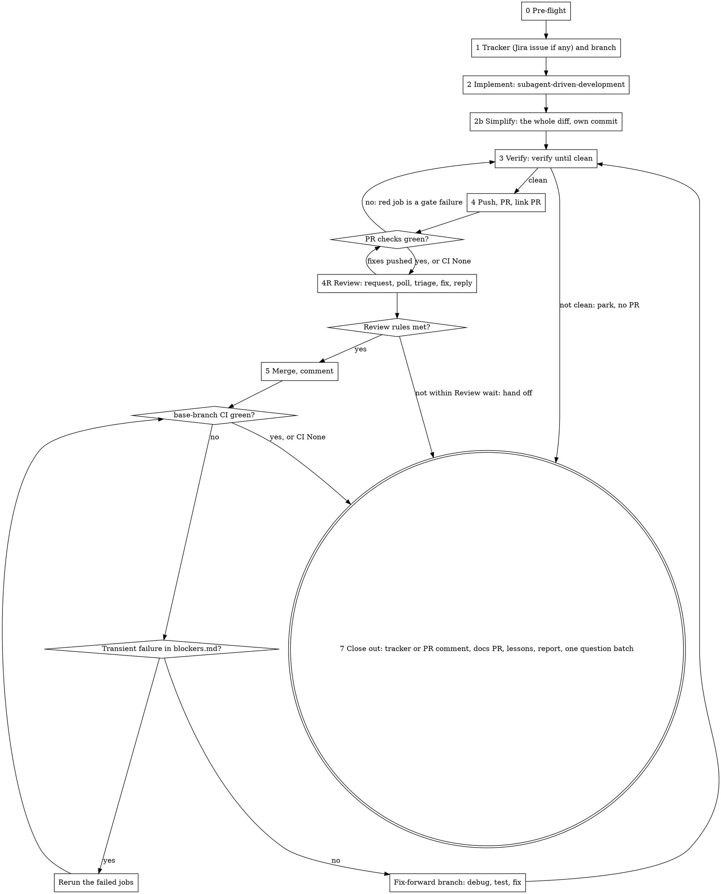

# Ship a plan

One run takes a written plan to a merged PR on a green base branch, tracked in
a Jira issue unless the user answers that the work has none. **The user starts this skill so they can
walk away.** Every question you ask costs them a context switch. Each run
should need fewer questions than the last, and the repo's two logs are how that
happens.

**Before anything else, read the repo's `.claude/ship-plan.md`
([format](config-format.md)), `.claude/ship-plan/interruptions.md` and
`.claude/ship-plan/blockers.md` in full.** The config holds every command and
setting for this repo. The first log holds standing answers to questions
earlier runs asked; the second holds the fixes for tooling that stopped earlier
runs. A question that has a standing answer is not asked again. Missing log
files are created from [log-formats.md](log-formats.md) at close-out.

## What invoking this skill authorizes

Invoking the skill is the user's standing authorization, for this run, to:

- create the feature branch, commit, and push it (never with `--force`);
- open the PR, rerun failed CI jobs, and merge it once every check is green and the repo's review rules are met (section 4R);
- request a Copilot review, and everything `verify-and-fix` section 4b allows on the PR: commit and push fixes for review comments, reply in review threads, resolve Copilot's threads, and re-request a reviewer whose requested changes were addressed or whose approval a push dismissed;
- open, push and merge follow-up branches that fix a red base branch caused by this run, including a revert PR;
- post a review request for each PR it opens to the Slack channel recorded in `## Slack` (section 0, step 6; section 4R, step 2), and never to any other channel;
- read and write the run's Jira issue — the one found or chosen in pre-flight (section 0, step 5): create it in the project and epic the user chose, link it to the related issue the user chose, assign it, transition it, append to its description, add comments;
- open, push and merge the docs branch that a `Docs PR:` line names (section 7, step 3): the spec `ship-issue` kept out of the code PR, and the docs changes the spec lists;
- open, push and merge the docs-only lessons branch (section 8).

It does **not** authorize the following. Each goes into the question batch (section 3), never done on your own:

- a push to the base branch, `--force`, `--admin`, `--no-verify`, disabling a hook or a check;
- approving the PR, dismissing a review, resolving a human reviewer's thread, or requesting a reviewer other than Copilot (code owners are requested by GitHub);
- any deploy or production write;
- a write to a shared environment's data;
- deleting a branch, file or row you did not create;
- spending money (paid APIs, a paid service);
- editing Claude Code settings files or any skill's `allowed-tools`;
- everything under the config's `## Never do`.

The config can add to this list, never remove from it.

`superpowers:subagent-driven-development` and `verify-and-fix` both say that a push, a
PR or a merge needs the user. Under this skill, the lists above replace that
rule.

**The frontmatter's `allowed-tools` pre-approves these commands** for the turn
that invoked the skill. They only match when written exactly as this skill
writes them:

- **every push names its branch:** `git push origin <branch>`. A bare `git push` is not pre-approved, and on the base branch it would push to it;
- merges: `gh pr merge <n> --squash --delete-branch`, or `--merge` when the config says `Merge: merge`;
- reruns: `gh run rerun <id> --failed`;
- reverts: `git revert --no-edit <sha>`;
- fetch, stage and commit (`git fetch origin <ref>`, `git add <files>`, `git commit`) are local and pre-approved. Run a fetch and a merge as two separate commands, never joined with `&&`.

Gate and prerequisite commands from the config are not pre-approved. In a
permission mode that prompts, list them in the pre-flight batch with the exact
allow lines (`Bash(<command>)`) for the user to add, so the run does not stall
on its first gate.

The pre-approval clears when the user sends a message. So every question you
ask ends with: **"Answer with `/ship-plan <your answers>`,"** which starts the
skill again, renews the pre-approval, and resumes from the ledger. A command
still refused after that goes into the batch (section 5, step 4).

## The run



The run ends at section 7 and nowhere else. Waiting on CI is not an end, and
neither is a pending question when other work remains.

### The ledger

`.superpowers/ship-plan/<branch>/ledger.md` (`.superpowers/` goes in
`.git/info/exclude`, never `.gitignore`). Its first line is always
`Phase: <n> | Plan: <path> | Issue: <id or none> | PR: #<n> | merge: <sha> | base run: <id>`,
rewritten as each value becomes known; a finished run ends with `Phase: done`. Below it, one line per event: phase
changes, `Ruling:` lines, `Asked:` lines (every question put to the user, with
its answer), questions parked, CI results, `Lesson:` lines.
**After a context compaction, resume from this line and `git log`, not from
memory.** `questions.md` sits next to it (section 3). `verify-and-fix` keeps its own
ledger in `.superpowers/verify-and-fix/<branch>/`; link to it rather than copying from it.

## 0. Pre-flight

The user has just invoked the skill and is probably still there. This is the
cheapest moment to ask anything, and the last one until the end.

1. **Config.** No `.claude/ship-plan.md`: draft it ([config-format.md](config-format.md), "Drafting a missing config"). The draft goes at the top of the batch. Implementation proceeds; `verify-and-fix` runs no gate until the user confirms the draft. An existing config is read by its reading rules: every unknown config section goes at the top of the batch, and a near-miss of `Never do`, `Fix rules` or `Security extras` is applied anyway and flagged.
2. **Resume or start.** List `.superpowers/ship-plan/*/ledger.md`. A ledger whose first line is not `Phase: done` is an open run. If the argument is not a plan path or an issue key that starts a new run, and an open run exists, this is a resumed run and the argument (if any) is answers: apply them to the parked questions, record each, switch to that ledger's branch if the checkout is on the base branch and clean (otherwise put it in the batch; and if its PR is already merged, the branch is gone: stay on the base branch), and continue from its first line. Several open runs: ask which one. **A run that is done is never resumed, and its plan is never shipped again**: step 3 skips any plan named in a `Phase: done` ledger.
3. **Resolve the plan.** A path; or a Jira issue key (the issue description may be the plan; with Jira unavailable there is no plan, so park it and ask now). No argument and no open run: stop with "Nothing to resume. Name the plan to ship." Never pick a plan on your own: a `/loop` left running after a run finished would start shipping something nobody asked for. **A plan written by `ship-issue`** has a `From ship-issue` block in its close-out notes: copy its `Ruling:`, `Parked:`, `Asked:`, `Lesson:` and `Docs PR:` lines into the ledger now, so they reach the PR body, the questions, the docs PR (section 7, step 3) and section 8.
4. **Check tools and auth, in parallel:** `gh auth status`; `atlassianUserInfo` (its `account_id` is the assignee for every Jira call); `git fetch origin <base> --quiet`, then `git status --porcelain`. A dirty working tree that is not yours goes in the batch; never stash or discard it. **Jira unavailable** (not connected, or the call fails): park "Jira unavailable: <exact error>" in the batch, continue with no Jira issue (the PR body carries the plan), and say so in the report. Never retry it through another route. **A Jira call that fails later in the run** gets the same rule; if the PR already exists, post its Plan section as a `gh pr comment`.
5. **The Jira issue.** Take the key, stopping at the first hit: the argument; the plan's header, "Source:" line or `From ship-issue` block; the current branch name, if this run started that branch. No key: ask templates.md's "Jira: issue question" **now, and wait for the answer** before anything that depends on it (the branch name does). It offers "No Jira issue": that answer is accepted, recorded as a `Ruling: user <date>`, and the run continues with no tracker (section 1).
6. **Slack channel.** Read `## Slack` from the config, else from `.claude/ship-plan.local.md` (a git-ignored file on this machine). Either says where review requests go: a channel, or `none`. **Neither has it:** ask now, before the run goes on, in this step's own `AskUserQuestion` call (its answer comes back in the same turn, so no answer line is needed): "Post a review request to Slack when the PR is created?"
   - Options: up to 2 channels found with `slack_search_channels` (`channel_types: "public_channel,private_channel"`, keywords from the repo name, its team, or "review"), as `#<name>`, the most relevant one recommended; "Don't post to Slack", recommended when no channel was found. "Other" takes a channel name: resolve it to an id with the same search. Not found: ask once more with the closest matches; still not found: don't post this run, and record nothing.
   - **Record it twice.** Now: write `## Slack` with `Channel: #<name> (<id>)`, or `Channel: none`, to `.claude/ship-plan.local.md`, and add that path to `.git/info/exclude`. It survives branch switches, reverts and unmerged PRs, so this machine never asks again. For the team: once section 1 has created the feature branch, add the same `## Slack` section to `.claude/ship-plan.md` as the first commit (`chore: record Slack channel for review requests`). A drafted config gets it inside the draft instead, committed when the draft is confirmed.
   - Keep the `Asked:` and `Ruling: user <date>` lines in the conversation until the ledger exists, then write them.
   - Slack tools not connected: don't post, record nothing, and write a `Lesson:` once the ledger exists.
7. **Predict what the run will need from the user,** by reading the plan: every task marked `[needs a decision]`, "ask the user", "confirm", or open questions; hosted sign-ins for the config's `## UI testing`; anything on the "does not authorize" list.
8. **Answer what you can.** Apply every standing answer from `interruptions.md`, and decide every question the confidence test (section 3) allows. Record each as a `Ruling:` line.
9. **Ask the rest in one message** (ending with the `/ship-plan` answer line), using `AskUserQuestion` (at most 4 questions; the recommended option first, marked "(Recommended)"). More than 4, or questions that need free text: one numbered message. Say that you'll continue with everything that doesn't depend on the answers. If nothing is left to ask, don't ask anything and start.

Except for steps 5 and 6, do not wait for the answers. Start section 1 and every task that doesn't depend on them.

## 1. Tracker and branch

**With a Jira issue** (pre-flight step 5 found one, or created it from the
user's answer). Site, issue type, extra fields and transitions come from the
config's `## Jira` (or the draft made from "Jira: issue question"); follow its
`Notes:`. Every Jira call passes `Site:` as `cloudId`. Templates are in
[templates.md](templates.md).

Start the work: `editJiraIssue` with the `assignee` set to your account id,
then `transitionJiraIssue` with `transitionName: <Start transition>`. Skip the
transition if the issue is already in the status it leads to. If the
description does not already contain the plan, append it ("Jira: plan
appended"). Never overwrite what the user wrote.

Do not assume an integration closes the issue. You apply the done transition,
only when the config's `Done means:` is met. If something sets
it earlier, leave the status alone while reruns or fixes are still running, so
it does not flip back and forth, and record a `Lesson:`: an integration now
closes issues, and the config's `Notes:` need correcting.

**No Jira issue** (the user answered "No Jira issue", or Jira is unavailable). No tracker step. The plan goes into the PR body
(templates.md, "PR body").

**Branch.** If you are on the base branch, create the branch from
`origin/<base>` in the current checkout (`git switch -c <name> origin/<base>`),
named by the config's `Branch:` pattern: `<type>/<slug>`, or `<type>/<id>-<slug>`
with an issue. `<type>` is `feature`, `fix`, `docs`, `chore` or `refactor`,
whichever fits the plan. `<slug>` is 3–6 words of the title in kebab case.
Keep the issue key upper case (`feature/PROJ-123-export-notes`): the GitHub for
Jira integration links the branch, its commits and its PR to the issue by that
key. Never prefix a branch with a username. Do not
create a worktree on your own: a fresh worktree lacks untracked files the repo
needs (dependencies, env files). If the current checkout is on another branch
or dirty, put it in the batch; never switch it. If you are already on a branch
for this plan, stay on it; if its name does not start with one of the five types, the pre-approved push and switch patterns don't match it, so put `Bash(git push origin <branch>)` and `Bash(git push -u origin <branch>)` in the pre-flight batch as allow lines.

## 2. Implement

**REQUIRED SUB-SKILL:** superpowers:subagent-driven-development, on the branch from section 1. Six adjustments:

- **Its pre-flight concerns and rulings** follow its own "Rulings, not stalls" rule. Anything it would stop for goes into `questions.md` (section 3). The run goes on with the tasks that don't depend on it.
- **Before it deletes its workspace,** copy every `Ruling:` line from its `progress.md` into this ledger. They go to the user in the report and the closing comment.
- **Skip its last step,** `finishing-a-development-branch`. Its menu is the question this skill already answered. Go to section 2b.
- **Every implementer dispatch carries the commit trailers verbatim,** with the words "copy them exactly; do not substitute your own model name". Implementers given the lines without that sentence have written their own trailer, and a haiku implementer did so even with it (ORIG-8343).
- **Check the trailers before each task review**, while the commits are still unpushed: `git log --format='%h %s%n%(trailers:only)' <BASE>..HEAD`, where `<BASE>` is the commit recorded before the dispatch. Fix any commit whose trailers differ from the session's with one command: `git rebase <BASE> -x 'git -c trailer.ifexists=replace commit --amend --no-edit --trailer "<trailer line 1>" --trailer "<trailer line 2>"'`. It replaces a wrong trailer, leaves a right one as it is, and changes only this task's commits. Record a `Ruling:`. A wrong trailer that is already pushed stays: fixing it needs a force-push, which this skill never does.
- **Every dispatch passes `model` and `effort`,** from the config's `## Models` ([config-format.md](config-format.md)): the implementer row the task's `Tier:` line picks (`Implementer (mechanical)`, `Implementer`, `Implementer (complex)`; untagged is `Implementer`), `Task review` for its spec and quality reviewers, `Escalation` for fix rounds 4–5 and any re-dispatch of a stuck implementer, `Final review` for the whole-branch review. These replace its Model Selection tiers. Never leave either out: an omitted model inherits this session's. **A tier may be raised, never lowered:** when a task turns out harder than its tag (a mechanical task that touches an authorization check), dispatch it a tier up and record a `Ruling:` with the reason. **A batch** (its "Batch small same-shape work") takes the highest tier among its tasks.

## 2b. Simplify

One pass over the whole branch, after the last task and its final review, and
before `verify-and-fix`. The per-task reviewers each see one task, so code
duplicated across tasks only shows here. It runs before verification, not in
the review round: it edits code, and the review agents read the code in
parallel. Nothing runs it on its own: an agent description that says
"triggered automatically" is a hint to the model, and under this skill only
the steps below dispatch it.

1. Rewrite the ledger's first line to `Phase: 2b`. The tree is clean after section 2; if `git status --short` shows anything, section 2 is not finished: finish it first.
2. Dispatch `pr-review-toolkit:code-simplifier` with the `Simplify` row of `## Models` (default `sonnet`, `high`) and this prompt, every `<…>` filled in:

   ```
   Simplify the code this branch adds or changes, without changing what it does.

   Scope: the files in `git diff --name-only origin/<base>...HEAD`, and in
   them only the lines that diff adds or changes. You were dispatched fresh:
   "recently modified" and "the current session" mean this diff.

   Standards: the repo's agent instructions (<paths of CLAUDE.md / AGENTS.md
   that apply>) and the code around each change. They replace the JavaScript
   and React list in your own instructions wherever the two differ.

   Settled, do not undo: the plan <plan path> and these rulings:
   <every Ruling: line in this ledger>

   Edit only what keeps behaviour: names, nesting, a duplicate helper merged,
   dead code removed. Never change a public signature, a test's assertions,
   or a log or error message text, and never delete a test. Anything larger
   is a finding, not an edit. Do not commit, push or switch branches.

   End with: one line per edit (file:line, what, why), then `Findings:` with
   one line each (file:line, what you would change), or `none`.
   ```
3. **Commit its edits on their own**, in the repo's commit format (for example `refactor: simplify <area>`), with the commit trailers. Write `Simplify: <short sha> — <n> edits` in the ledger. No edits: `Simplify: no changes`, and a `Ruling: simplify pass made no edits — <its report's first line> — none`. Each of its `Findings:` lines goes in the ledger as `Simplify finding: <line>`. They are not fixed here: one the review round also raises is fixed there, and the rest go under Follow-ups in the closing comment.
4. **If the agent is unavailable,** dispatch `general-purpose` with the same prompt and row, and write a `Ruling:` saying so.

**Resuming at `Phase: 2b`** with no `Simplify:` line: a dirty tree holds the
simplifier's edits (the tasks are all committed); commit them as step 3 says.
A clean tree: dispatch again.

## 3. Questions

Every time you'd want to ask the user something:

1. **Check `interruptions.md`.** If there is a standing answer, apply it and note `Ruling: standing answer <entry>`.
2. **Apply the confidence test.** Decide it yourself, with a `Ruling: <decision> — <evidence quoted> — <cost if wrong>` line, when **all four** hold:
   - the plan, the spec, the repo's agent instructions, a standing answer, or existing code points one way, and you can quote it;
   - a follow-up commit can undo it;
   - it is not in the "does not authorize" list;
   - it doesn't **widen** access or change money: nothing new becomes visible or allowed to a role, and nothing changes what a customer is charged. Those need the user, even if you are confident. **Narrowing access to what the spec already states,** through the repo's existing mechanism (its access-control layer, an existing role check), passes this part. It is a security fix, not a product decision. Pick the variant the codebase already uses for the same case, and quote that sibling.
3. **"Should we go beyond the spec?"** (widen a role, add a feature the spec leaves out) is not a question for this run. Rule for what the spec says, and list the alternative under Follow-ups in the closing comment.
4. **Otherwise, park it** in `questions.md`: the question, the options, your recommendation, and what is blocked by it. Then keep working on everything else.
5. **Ask only when nothing unblocked is left.** Then ask the whole of `questions.md` at once. The usual moment is the close-out (section 7). Mid-run, the only reason is that every remaining path is blocked, for example a denied merge with nothing else to do.

A failing gate, a red CI job, a flaky test, or a merge conflict is **work, not
a question.** `verify-and-fix`'s section 6 stop conditions are parked here, not asked
on the spot, except for a destructive action.

## 4. Verify, push, PR

1. **REQUIRED SUB-SKILL:** `verify-and-fix`. Run it until it reports `clean` or `clean before merge; N scenarios pending`. Its setup step collects its own questions; those go into `questions.md` unless blocked. Pending scenarios are listed in the ledger as **pending after merge**.
   `not clean: <reason>`: never push and never open the PR. A reason the loop can still work on (a gate failure, a review finding) is work: keep going. A reason that needs the user (an unconfirmed draft config, a gate that could not run, no gates, round 5, a fix that still fails) is parked in `questions.md`; when nothing unblocked is left, go to close-out (section 7) with no PR, and ask the batch. Never call `verify-and-fix` again on an unchanged reason.
2. **Push:** `git push -u origin <branch>`.
3. **Open the PR:** `gh pr create --base <base>`. Title: the outcome in plain words, plus ` (<ID>)` when there is an issue. Body: templates.md, "PR body" (with its `## Plan` section when there is no Jira issue). It ends with the attribution line.
4. **Ask for review** (section 4R, steps 1–2): record the review rule, request Copilot, post the Slack review request, and with a Jira issue apply the `Review transition:` if the config names one. CI and the reviews run in parallel.
5. **With a Jira issue:** no link call. The issue key in the branch name and the PR title is what links the PR to the issue (GitHub for Jira). If the PR does not show on the issue's Development panel, record a `Lesson:`; the "Merged" comment carries the PR link either way.
6. **Wait for checks:** `gh pr checks <n> --watch --fail-fast` with `run_in_background`. While waiting, draft the closing comments. If it answers "no checks reported":
   - **CI None** — the config's `## CI` says `None`, or `.github/workflows/` holds no workflow file: there is nothing to wait for. Record `CI: None` in the ledger and go to section 4R. This is not a question: the repo has no CI, and `verify-and-fix` clean is the gate.
   - Otherwise read each workflow's `on:` block: its `pull_request` trigger, branch filters and `paths` / `paths-ignore`. **No workflow covers this PR** (a docs-only diff under `paths-ignore`, a PR-only filter that excludes this base): there is no PR CI for this diff. Record "no PR CI for this diff", go to section 4R, and say so in the report.
   - A workflow does cover it: CI has not registered yet. Wait up to 10 minutes, then treat it as a blocker: park it and close out with the PR open ("not merged").
7. **A red check:** `gh run view <run-id> --log-failed | tail -150`.
   - A transient failure listed in `blockers.md`: `gh run rerun <run-id> --failed`.
   - Anything else is a gate failure. Back to `verify-and-fix` (with `--comments` once the PR is in review, so only the fix is re-reviewed): fix it with a test first, run the gates, then run a review round unless the fix keeps behaviour. Commit, `git push origin <branch>`, and wait again.
8. **Every check green:** section 4R.

## 4R. Review

Steps 1 and 2 run as soon as the PR is created (section 4, step 4), so the
Slack request and the Copilot review go out right away; the rest starts once
the PR's checks are green (or there is no PR CI). Most repos
require an approval from someone other than the author, and reviewers, people
or Copilot, leave comments. This section waits for them, has `verify-and-fix`
handle every comment, and goes to section 5 only when the repo's review rules
are met. It ends in one of three ways: merge (section 5), hand off (section 7,
"awaiting review"), or not merged.

`<o>/<r>` is `gh repo view --json nameWithOwner --jq .nameWithOwner`. `<host>` is the host of `gh repo view --json url --jq .url` (`github.com`, or a GitHub Enterprise host). Append `--hostname <host>` to every `gh api` call, after its other arguments: `gh api` does not read the host from the git remote the way `gh pr` does, so on GitHub Enterprise it asks `github.com` and answers 404, or another account's login.

1. **What the repo requires,** once per run. Record
   `Review rule: approvals <n> | code owners <yes/no> | stale dismissed <yes/no> | threads must be resolved <yes/no> | source <config/ruleset/protection/unknown>`:
   - **The rulesets:** `gh api repos/<o>/<r>/rules/branches/<base> --hostname <host>`. Every rule with `"type": "pull_request"` counts; take the strictest of each of `required_approving_review_count`, `require_code_owner_review`, `dismiss_stale_reviews_on_push` and `required_review_thread_resolution` from its `parameters`.
   - **Else classic branch protection:** `gh api repos/<o>/<r>/branches/<base>/protection/required_pull_request_reviews --hostname <host>`. A 403 or 404 means unknown, not none.
   - **The config's `Approvals:`** (`## Repo`: `none` for POCs and internal tools, or a number) applies when neither could be read, and can raise what they say, never lower it: GitHub enforces its own rules whatever the config says.
   - **Nothing readable and no `Approvals:`:** assume 1.
2. **Request reviews,** right after the PR opens. Code owners are requested by GitHub; request nobody else. **Copilot,** unless the config says `Copilot review: no`, `blockers.md` records that Copilot review is unavailable here, or `gh pr view <n> --json reviewRequests,reviews` already shows it (a ruleset can request it automatically): `gh pr edit <n> --add-reviewer @copilot`. If that is refused, go on without it, record a `Lesson:` for `blockers.md` ("Copilot review unavailable: <error>"), and propose `Copilot review: no` as a config change. Never try another route.
   **Slack,** when `## Slack` (config, else `.claude/ship-plan.local.md`) names a channel: `slack_send_message` with its `channel_id`, the "Slack: review request" text (templates.md) and `unfurl_app_links: true`, unless a standing answer in `interruptions.md` says otherwise (it outranks this default, as every standing answer does). Read it before the post: the message cannot be edited or deleted afterwards. Once per PR: record `Slack: posted <ts>` in the ledger and never post again for that PR, also not on a resume. Fix-forward, revert and lessons PRs are posted only when the review rule needs an approval. A failed post is a `Lesson:`, never retried another way, and never a reason to stop.
3. **Poll:** `gh pr view <n> --json reviewDecision,reviews,reviewRequests,mergeStateStatus,statusCheckRollup`, and the threads and comments the way `verify-and-fix` section 4b fetches them.
   - **New feedback** (as `verify-and-fix` 4b defines it): run `verify-and-fix --comments`. It grades, fixes, runs the gates, pushes, replies, resolves Copilot's threads and re-requests reviewers, without a full review round of code the reviewers already saw. Then, with a Jira issue, post "Jira comment: review round" from its review-item table, wait for the checks (section 4, step 6), and poll again. Count the round.
   - **The review rules are met:** section 5. Met means all of: **approvals**: in `reviews`, take each reviewer's latest review, leave out yours and Copilot's, and count those in state `APPROVED`; the count reaches the rule's number, no latest review is `CHANGES_REQUESTED`, and `reviewDecision` is `APPROVED` or empty (GitHub leaves it empty when no rule requires review; when a rule does, `APPROVED` also covers code owners); no review pending from Copilot in `reviewRequests` (a push can re-request it: wait for it, at most 20 minutes when nothing else is pending, then go on and record a `Lesson:`); no item without a reply; no item graded "needs the user" still undecided (it blocks the merge even though it has a reply); and, when threads must be resolved, every thread resolved.
   - **Otherwise wait:** `sleep 300` with `run_in_background`, then poll again. The window is the config's `Review wait:` (default 120 minutes), counted from the first poll of this session. A resumed run gets a window only when it finds new feedback (step 6). When it runs out, hand off (step 5).
4. **At most 5 review rounds** per run. A review round here is one `verify-and-fix --comments` call; its own round count starts again with each call. After the 5th, park "review still open after 5 rounds" and hand off.
5. **Hand off** when the window runs out, or earlier when a parked decision blocks every remaining path (a comment graded "needs the user"). Waiting for an approval or for a person to resolve their thread is what the window is for. Rewrite the ledger's first line with `Phase: 4R awaiting review`, stay on the feature branch, and close out (section 7, "Awaiting review"). **Lessons wait for the final close-out:** no lessons branch now, so the checkout stays on the feature branch and the ledger is found again.
6. **Resumed while awaiting review** (`/ship-plan` again, or `/loop 30m /ship-plan`): poll once at once. Nothing new and the rules not met: end with one line, "still awaiting review: <what>", with no Jira comment, no lessons and no new window, so a loop does not pile up. New feedback: step 3, with a fresh window. Rules met: section 5.

## 5. Merge

1. `gh pr view <n> --json mergeable,mergeStateStatus,statusCheckRollup,reviewDecision`. Every check must be `SUCCESS` or `SKIPPED`. CI None, or no PR CI for this diff: there are no checks to read; `verify-and-fix` clean is the gate. **`reviewDecision` is `REVIEW_REQUIRED` or `CHANGES_REQUESTED`, or `mergeStateStatus` is `BLOCKED` with every check green:** the review rules are not met after all (a code owner, an unresolved thread, a rule section 4R could not read). Never use `--admin`, and never approve. Record what blocks the merge, then back to section 4R's wait (`sleep 300` first, never straight back); if its window has run out, hand off.
2. **Behind the base branch or conflicting:** fetch the PR branch first (`git fetch origin <branch>`): the user may already have pressed GitHub's "Update branch". Then `git fetch origin <base>`, and as a separate command `git merge origin/<base>` (a merge, not a rebase, so no force-push). Resolve conflicts. If the merge brought in changes to files this branch touches, rerun the gates whose paths the merge touched. If this branch copies code, run `verify-and-fix`'s "other copies of the same source" check again: a PR that merged first may have brought its own copy. `git push origin <branch>`, and go back to 4.6. Then read `reviews` again: when the push dismissed an approval (that reviewer's latest review is now `DISMISSED`; resolving a conflict can change the diff), re-request them with `gh pr edit <n> --add-reviewer <login>` (authorized above). The push can also start a new Copilot review; section 4R waits for it. If the push is refused as non-fast-forward and `git diff HEAD origin/<branch>` is empty, `git reset --keep origin/<branch>` adopts their merge; anything else is someone's work, so stop and look.
   **A check red only because the base branch is red** (the same test fails on the base branch's own run, from someone else's change): never merge red and never fix that here. Poll the base branch's runs in the background; once one is green, merge `origin/<base>` as above. Still red when nothing else is left: park it and close out with the PR open.
3. Merge with the configured method: `gh pr merge <n> --squash --delete-branch` (or `--merge`). Record the merge SHA: `gh pr view <n> --json mergeCommit --jq .mergeCommit.oid`. `--delete-branch` also switches the local checkout to the base branch and deletes the local feature branch; continue from there (sections 6–8 branch from `origin/<base>`), and read this run's ledger by its path, since the branch it is named after is gone.
4. **The merge is refused** by the permission system, or by GitHub (a disallowed merge method, a branch policy): do not retry it, and do not try another route. It is now blocking, so ask the whole batch now. For a permission refusal, record it as a `Lesson:` proposing the exact `allowed-tools` line; section 8 writes the `interruptions.md` entry, so the next run is not refused.
5. **With a Jira issue:** comment "Merged" (templates.md). Do not apply the done transition yet.

## 6. Base-branch CI

CI None: skip this section and record "base branch has no CI".

1. Find the push run: `gh run list --workflow=<config Workflow> --branch=<base> --commit <sha> --json databaseId,status` (no `Workflow:` configured: `gh run list --branch <base> --commit <sha> --json databaseId,status,workflowName`, and watch every run). It may take a few seconds to appear. **No run for `<sha>` within 5 minutes** (the workflows do not run on pushes, or their path filters exclude this commit): record "no base-branch run for `<sha>`", treat it like CI None for this merge, and say so in the report. Otherwise `gh run watch <id> --exit-status` with `run_in_background`. If it exits 1, check `gh run view <id> --json status,conclusion` before calling the run red: `gh run watch` also exits 1 on a transient GitHub API error while the run carries on.
2. **Green**, as the config's `Green:` defines: go to 7.
3. **Red:** `gh run view <id> --log-failed | tail -150`, then classify:
   - **Transient, listed in `blockers.md`:** `gh run rerun <id> --failed`, then watch again. Up to 3 reruns. Before the 2nd and 3rd, wait 10 and then 20 minutes: run `sleep 600` (then `sleep 1200`) with `run_in_background`, and rerun when it finishes. Keep the rerun a separate command, so it matches the pre-approval. After the 3rd, park it in `questions.md` and go on to close-out; the work is not done.
   - **A new transient** (an external service down, a registry, the network, and the same step passed on the PR): treat it as above, then add it to `blockers.md` at close-out.
   - **Real:** fix forward. `git switch -c fix/<id-or-slug>-base-after-<pr> origin/<base>`. Find the root cause (superpowers:systematic-debugging), write a failing test, fix, run `verify-and-fix` on this branch, then do sections 4–6 again with the title "Fix <base> after #<n>: <what>".
   - **The root cause isn't found in one attempt,** or the fix is not small: revert instead. A squash merge is an ordinary commit, so run `git revert --no-edit <merge sha>` on a new branch `fix/revert-<pr>` from `origin/<base>` (no `-m`), PR it, and merge it through the same loop. With a Jira issue: if the issue has left the start status, apply the `Start transition:` again, with the failure in a comment. Park the question of how to reland it.
4. **At most 3 fix-forward cycles** in one run. After that, stop fixing: the base branch is red, and that is the first line of the report and of the question batch.

While a deploy step on the base branch is red, what it deploys may be
half-updated. Say so in the closing comment until it is green.

## 7. Close out

1. **The config's `## After merge` checks,** read-only.
2. **Closing comment.**
   Four outcomes, one template each (templates.md):
   - **Done:** merged, and the base branch green, or no CI (CI None, no base-branch run for the merge). With a Jira issue: "Jira comment: done", then `transitionJiraIssue` with `transitionName: <Done transition>`, **only when `Done means:` is met** (with CI None, Done means is "merged"). Not configured: `gh pr comment <n>` with "PR comment: done". Before writing it, read the `blockers.md` entries about what the base branch's workflows do after a merge (for example a chart bump PR their bot opens and merges), check each one, and report its real state in the comment.
   - **Base branch red:** merged, and the base branch still red. "Jira comment: base branch red" or "PR comment: base branch red"; the issue stays in the start status.
   - **Awaiting review:** the PR is open, green, and every comment so far is handled, but it waits on reviewers (section 4R, step 5). "Jira comment: awaiting review"; without Jira, the report only (the PR shows its own state). The issue stays in its status. The report says how to resume.
   - **Not merged:** the PR is still open for another reason (verify not clean, checks never registered, the base branch red before merge, a refused merge, 5 review rounds), or no PR exists. "Jira comment: not merged" or "PR comment: not merged"; with no PR and no Jira, the report is the only record.
3. **Docs PR,** when the ledger has a `Docs PR:` line (`ship-issue` held the spec out of the code PR, because the repo keeps docs and code in separate PRs) and the code PR has merged. Under "Awaiting review" and "Not merged" it waits: the docs describe code that is not on the base branch yet. Nothing else opens it: without this step the spec stays git-ignored in the ledger directory and never reaches the repository.
   1. In the same checkout, never a second worktree (a worktree-isolated session cannot write to one): `git fetch origin <base>`, then `git switch -c docs/<ID>-<slug> origin/<base>`, with the feature branch's `<slug>`.
   2. Copy the held spec to the path the line names (`docs/superpowers/specs/…`), and rewrite only the spec's own line about where it lives. Make the other changes the line lists: rows in the agent instructions, an ADR the spec asks for, a pointer in an ADR it supersedes (only a proposed one; an accepted ADR is append-only).
   3. Check every name, path and test the new text cites against `origin/<base>` with `git grep`. Fix the text, never the code.
   4. Commit (`docs: <what> (<ID>)`), `git push -u origin <branch>`, and `gh pr create --base <base>`. The body names the code PR and its merge SHA, and ends with the attribution line.
   5. Request Copilot, and post the Slack review request (section 4R, step 2) when the review rule needs an approval. If the review rule needs no approval, merge it through sections 5–6. Otherwise leave it open and link it in the report as "docs PR, needs approval"; it never holds the run open.
   6. Write `Docs PR: #<n> <url>` in the ledger. With a Jira issue, name it in the Done comment's follow-ups.
4. **Lessons** (section 8), except under "Awaiting review": they wait for the run's final close-out.
5. **Report,** concise, in this order:
   1. **Needs you:** the batch.
   2. Status: base branch green or red (or "no CI"), PR, merge SHA, the docs PR, the issue link if any.
   3. Gate and scenario tables (from `verify-and-fix`), the `Simplify:` line, and every unknown config section.
   4. **Decisions made for you:** every `Ruling:`, each with what it costs if wrong.
   5. **Not tested:** what, and why.
   6. The lessons recorded, and any proposed skill change.
6. **Mark the ledger** `Phase: done` when the outcome is Done, and if this run was started by `/loop`, end the report with "Done: stop the `/loop`." Every other outcome keeps the run open, so a later `/ship-plan` resumes it.
7. **Ask the batch once,** after the report, with `AskUserQuestion` when the answers are choices. When the user answers, carry on: run the pending scenarios once they have signed in, add a new tracker or PR comment, and record each answer in `interruptions.md`.

## 8. Lessons

At close-out, before the report, on a branch from `origin/<base>`
(`docs/ship-plan-lessons-<yyyy-mm-dd>`), never on the feature branch:

- **Every question you asked this run** (pre-flight, mid-run, final) becomes an `.claude/ship-plan/interruptions.md` entry. When the user answers, fill in the answer and a **standing answer**: the rule that lets the next run decide on its own.
- **Every ruling the user overturned** becomes an entry too. That is how the confidence test gets calibrated.
- **Every tooling blocker** you got past goes into `.claude/ship-plan/blockers.md`, in its format.
- Create either file from [log-formats.md](log-formats.md) if it is missing.
- **Under `ship-issue`** (the plan has a `From ship-issue` block): its `Asked:` lines (questions from phases I0–I6) go into `.claude/ship-issue/interruptions.md` instead, created from [../ship-issue/log-formats.md](../ship-issue/log-formats.md) if missing.
- **Config changes the user approved** go into `.claude/ship-plan.md` on the same branch. Exceptions, committed on the feature branch instead because the run needs them now: `## Slack` (section 0, step 6) and a drafted `## Jira`.
- **Lessons about the loop itself** (a missing step, a wrong order, a rule that misfired) go in the report as "proposed skill change", with the exact text. Never edit this skill's files on your own: every repo uses them, and they are published from their own git repository.
- **Batch empty:** open a docs-only PR and wait for its checks. If the review rule (section 4R, step 1) needs no approval, merge it through sections 5–6. Otherwise request Copilot, leave it open for review, and link it in the report as "lessons PR, needs approval"; it never holds the run open.
- **Batch not empty:** commit and push the branch with those entries marked `Answer: pending` *before* you ask, so the lessons survive if the session ends. When the answers come, fill them in, then open the PR and merge it the same way.

During the run, write lessons in the ledger as `Lesson:` lines. Editing the
log files on the feature branch mixes them into the product PR.

## Red flags

| Thought | Reality |
|---|---|
| "I'll ask about the merge / the rerun / the follow-up PR" | The authorization section covers these. Do them. |
| "Quick question, then I'll carry on" | Park it. Ask the batch when nothing unblocked is left. |
| "I'm fairly sure, but I'll check with the user" | Run the confidence test. If it passes, rule and record. |
| "I'll post the PR to the team channel, it's obviously the right one" | Only the channel in `## Slack` (config or local file). Neither: ask in pre-flight, and `none` means no post. |
| "Move it to In Review" | Use only the transitions the config names (`Review transition:`). |
| "Checks are green, merge" | Section 4R first: the review rules, Copilot's review, and every comment handled. |
| "No approval yet, I'll keep waiting" | Wait for `Review wait:`, then hand off. The run must end. |
| "I'll approve it / resolve their thread so it can merge" | Never. Approval and a person's thread belong to the reviewer. |
| "Copilot is a bot, its comments don't matter" | Grade every comment by what a user would get. A bot can be right. |
| "The reviewer is wrong, I'll ignore it" | Reply with the quoted evidence. Every thread gets an answer. |
| "Approved, and Copilot has one more suggestion: I'll push it" | If stale reviews are dismissed, that push throws the approval away. Reply "follow-up" instead. |
| "Jira already says done, fine" | Done means the config's `Done means:`. Check the base-branch run first. |
| "The PR is merged, so I'm done" | The run ends when the base branch is green, the closing comment is written, the docs PR is open (when the ledger has a `Docs PR:` line), and lessons are recorded. |
| "The spec can go in with some later docs change" | A held spec reaches the repository only through section 7, step 3. Open the docs PR at close-out. |
| "The base branch failed, probably flaky, rerun until it passes" | Only a failure listed as transient gets a rerun, and at most 3. Anything else gets a root cause. |
| "Push the fix straight to the base branch, it's one line" | Never push to the base branch. A fix branch goes through the same loop. |
| "The ruling is obvious, no need to write it down" | An unrecorded ruling is a decision made in secret. Write the ledger line. |
| "I'll update interruptions.md next time" | Next time is when it would have saved the question. Do it at close-out. |
| "Use a worktree for isolation" | A fresh worktree lacks the repo's untracked files. Use the current checkout; put a busy checkout in the batch. |
| "No issue key, so I'll create one in the config's project" | Ask "Jira: issue question" first. The project, the epic and the related issue are the user's choice. |
| "No Jira here, so I'll just note it in chat" | The PR is the record. Plan, rulings and verification go in its body. |
| "'No checks reported', I'll keep waiting" | No workflows means CI None. Otherwise 10 minutes, then park. |
| "No checks is not the same as checks passing, so I can't merge" | With CI None, `verify-and-fix` clean is the gate. The repo has no CI to pass; merge and report "base branch has no CI". |
| "Jira failed, I'll work around it some other way" | Park "Jira unavailable", continue without it, and say so in the report. |
