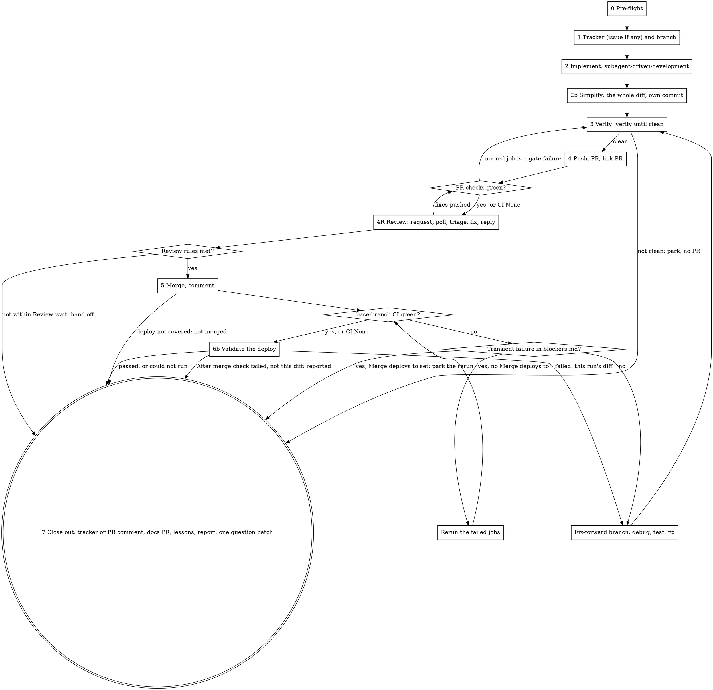

# Ship a plan

One run takes a written plan to a merged PR on a green base branch, tracked in
an issue in the repo's tracker unless the tracker is `none` or the user answers that the work has none. **The user starts this skill so they can
walk away.** Every question you ask costs them a context switch. Each run
should need fewer questions than the last, and the repo's two logs are how that
happens.

**Before anything else, read the repo's `.claude/ship-plan.md`
([format](config-format.md)), `.claude/ship-plan/interruptions.md` and
`.claude/ship-plan/blockers.md` in full.** The config holds every command and
setting for this repo. The first log holds standing answers to questions
earlier runs asked; the second holds the fixes for tooling that stopped earlier
runs. A question that has a standing answer is not asked again. Missing log
files are created from [log-formats.md](log-formats.md) at close-out.

**Repo override files** ([format](config-format.md#repo-override-files)):
whenever this skill reads one of its own files, read its counterpart under
`.claude/ship-plan/ship-plan/` next, if it exists: `.claude/ship-plan/ship-plan/SKILL.md`
right after this file, `.claude/ship-plan/ship-plan/hosts/github.md` after
`hosts/github.md`. A file of another skill (`../verify-and-fix/…`) has its
counterpart in that skill's folder. An override line that widens what the run
may do, or removes a step, is not applied, and the report names it.

- **A repo set up for `ship`:** if `.claude/ship.md` exists and `.claude/ship-plan.md` does not, stop with one line: "This repo is set up for the removed `ship` skill: move `.claude/ship.md` to `.claude/ship-plan.md` and `.claude/ship/` to `.claude/ship-plan/`."
- **Host and tracker:** resolve `Host:` and `Tracker:` as [config-format.md](config-format.md) says (`Host:` from the `origin` remote when absent; `Tracker:` from `## Jira` or `## Linear` when absent, else undecided until pre-flight step 5). Then read `hosts/<host>.md` (`github.md` or `azure-devops.md`) and, unless the tracker is `none` or undecided, `trackers/<tracker>.md` (`jira.md` or `linear.md`). A reference below to an operation of the host, the tracker or the notifier names the section of that name in those files and in `notifiers/slack.md`.
- **No `origin` remote** (and no `Host:`): there is no host and no PR to open. Read no host file, skip the host's *Auth check* and the `git fetch origin` in pre-flight step 4, and stop before section 4, saying so in the report.

## What invoking this skill authorizes

Invoking the skill is the user's standing authorization, for this run, to:

- create the feature branch, commit, and push it (never with `--force`);
- open the PR, rerun failed CI jobs, and merge it once every check is green and the repo's review rules are met (section 4R);
- request an AI review (the host's *Request an AI review*), and everything `verify-and-fix`'s review comments ([review-comments.md](../verify-and-fix/review-comments.md)) allow on the PR: commit and push fixes for review comments, reply in review threads, resolve bot reviewers' threads, as the host names them, and re-request a reviewer whose requested changes were addressed or whose approval a push dismissed;
- open, push and merge follow-up branches that fix a red base branch caused by this run, including a revert PR;
- in the Slack channel recorded in `## Slack` only, and never in any other channel: post a review request for each PR it opens (section 4R, step 2), reply in that post's thread to ask for a re-review (section 4R, step 3), and add the `pr-merged` reaction to that post (section 5);
- read and write the run's issue — the one found or chosen in pre-flight (section 0, step 5): create it where the user chose, link it to the related issue the user chose, assign it, set its status, append to its description, add comments;
- open, push and merge the docs branch that a `Docs PR:` line names (section 7, step 2): the spec `ship-issue` kept out of the code PR, and the docs changes the spec lists;
- open, push and merge the docs-only lessons branch (section 8).

It does **not** authorize the following. Each goes into the question batch (section 3), never done on your own:

- a push to the base branch, `--force`, `--admin`, `--no-verify`, disabling a hook or a check;
- approving the PR, dismissing a review, resolving a human reviewer's thread, or requesting a reviewer other than the AI reviewer (code owners are requested by the host);
- everything under the host's *Never*;
- any deploy or production write, except a merge whose base-branch deploy goes only to environments that `## Allowed` `Merge that deploys to:` covers ([config-format.md](config-format.md#-allowed));
- a write to a shared environment's data;
- deleting a branch, file or row you did not create;
- spending money (paid APIs, a paid service);
- editing Claude Code settings files or any skill's `allowed-tools`;
- everything under the config's `## Never do`.

Apart from `## Allowed`, the config can add to this list, never remove from it.

`superpowers:subagent-driven-development` and `verify-and-fix` both say that a push, a
PR or a merge needs the user. Under this skill, the lists above replace that
rule.

**The frontmatter's `allowed-tools` pre-approves these commands** for the turn
that invoked the skill. They only match when written exactly as this skill
and the host file write them:

- **every push names its branch:** `git push origin <branch>`. A bare `git push` is not pre-approved, and on the base branch it would push to it;
- merges: the host's *Merge the PR*, in the form the config's `Merge:` picks;
- reruns: the host's *Rerun a failed PR check*, and the host's *Rerun a base-branch run* where the host pre-approves it;
- reverts: `git revert --no-edit <sha>`;
- fetch, stage and commit (`git fetch origin <ref>`, `git add <files>`, `git commit`) are local and pre-approved. Run a fetch and a merge as two separate commands, never joined with `&&`.

Gate and prerequisite commands from the config are not pre-approved. In a
permission mode that prompts, list them in the pre-flight batch with the exact
allow lines (`Bash(<command>)`) for the user to add, so the run does not stall
on its first gate. Add the allow line the host's *Rerun a base-branch run*
gives, when it gives one.

The pre-approval clears when the user sends a message. So every question you
ask ends with: **"Answer with `/ship-plan <your answers>`,"** which starts the
skill again, renews the pre-approval, and resumes from the ledger. A command
still refused after that goes into the batch (section 5, step 5).

## The run



The run ends at section 7 and nowhere else. Waiting on CI is not an end, and
neither is a pending question when other work remains.

### The ledger

`.superpowers/ship-plan/<branch>/ledger.md` (`.superpowers/` goes in
`.git/info/exclude`, never `.gitignore`). Its first line is always
`Phase: <n> | Plan: <path> | Issue: <id or none> | PR: #<n> | merge: <sha> | base run: <id>`,
rewritten as each value becomes known; a finished run ends with `Phase: done`. Below it, one line per event: phase
changes, `Ruling:` lines, `Asked:` lines (every question put to the user, with
its answer), questions parked, CI results, `Lesson:` lines.
**After a context compaction, resume from this line and `git log`, not from
memory.** `questions.md` sits next to it (section 3). `verify-and-fix` keeps its own
ledger in `.superpowers/verify-and-fix/<branch>/`; link to it rather than copying from it.

**When the session ends before the run does** (a usage limit, the context
running out, a batch the user will answer later): bring the ledger up to date,
then write a handoff: the `handoff` skill when it is available, otherwise a
`HANDOFF.md` next to the ledger. Its resume line is `/ship-plan`, with no
argument: the ledger says where the run stands.

## 0. Pre-flight

The user has just invoked the skill and is probably still there. This is the
cheapest moment to ask anything, and the last one until the end.

1. **Config.** **When the config is missing or a section must be drafted, read [config-drafting.md](config-drafting.md).** Draft the config, or the section, as that file says; the draft goes at the top of the batch. Implementation proceeds; `verify-and-fix` runs no gate until the user confirms the draft. An existing config is read by its reading rules: every unknown config section goes at the top of the batch, and a near-miss of `Never do`, `Fix rules` or `Security extras` is applied anyway and flagged.
2. **Resume or start.** List `.superpowers/ship-plan/*/ledger.md`. A ledger whose first line is not `Phase: done` is an open run. If the argument is not a plan path or an issue key that starts a new run, and an open run exists, this is a resumed run and the argument (if any) is answers: apply them to the parked questions, record each, switch to that ledger's branch if the checkout is on the base branch and clean (otherwise put it in the batch; and if its PR is already merged, the branch is gone: stay on the base branch), and continue from its first line. Several open runs: ask which one. **A run that is done is never resumed, and its plan is never shipped again**: step 3 skips any plan named in a `Phase: done` ledger. One exception, for answers only: with no open run, a `Phase: done` ledger whose batch is unanswered (an `Asked: … — pending` line) takes an argument that is answers. Apply them to its parked items as section 7, step 7 and section 8 say (run the **Not tested** scenarios once the user has signed in, merge a lessons PR the batch asked about), then end again as done. It never re-runs the plan.
3. **Resolve the plan.** A path; or an issue key (the tracker's *Read an issue*: the issue description may be the plan; with the tracker unavailable there is no plan, so park it and ask now). No argument and no open run: stop with "Nothing to resume. Name the plan to ship." Never pick a plan on your own: a `/loop` left running after a run finished would start shipping something nobody asked for. **A plan written by `ship-issue`** has a `From ship-issue` block in its close-out notes: copy its `Ruling:`, `Parked:`, `Asked:`, `Lesson:` and `Docs PR:` lines into the ledger now, so they reach the PR body, the questions, the docs PR (section 7, step 2) and section 8.
4. **Check tools and auth, in parallel:** the host's *Auth check*; the tracker's *Auth*, unless the tracker is `none`; `git fetch origin <base> --quiet`, then `git status --porcelain`. A dirty working tree that is not yours goes in the batch; never stash or discard it. **The tracker unavailable** (not connected, or the call fails), now or later in the run: as the tracker's *Auth* says, park it with the exact error, continue with no issue (the PR body carries the plan), and say so in the report. Never retry it through another route.
5. **The issue.**
   - **`Tracker:` undecided** (no `Tracker:`, no `## Jira`, no `## Linear`): ask "Which tracker does this repo use?" ([templates-issue.md](templates-issue.md)) **now, and wait for the answer**, before the issue question. Write it as `Tracker: <jira, linear or none>` in the config's `## Repo`, with the tracker's section drafted from the issue question (the tracker's *Where a new issue goes*), as the feature branch's first commit once section 1 has created it (with `## Slack` when step 6 asked too). A drafted config gets it inside the draft instead. Then read `trackers/<tracker>.md`, unless the answer is `none`.
   - **`Tracker: none`:** there is no issue. The run takes the no-issue path (section 1).
   - **Otherwise take the key,** stopping at the first hit: the argument; the plan's header, "Source:" line or `From ship-issue` block; the current branch name, if this run started that branch (the tracker's *Issue keys*). No key: ask the "Issue question" ([templates-issue.md](templates-issue.md)) **now, and wait for the answer** before anything that depends on it (the branch name does). It offers "No issue": that answer is accepted, recorded as a `Ruling: user <date>`, and the run continues with no tracker (section 1).
6. **Slack channel.** Read `## Slack` from the config, else from `.claude/ship-plan.local.md` (a git-ignored file on this machine, read, never written). Either says where review requests go: a channel, or `none`. **When `## Slack` is missing from the config and from `.claude/ship-plan.local.md`, read [notifiers/slack.md](notifiers/slack.md) and choose the channel.** The notifier's *Choose the channel* asks the user, and this step waits for the answer. The answer is written to the committed config only. **When `## Slack` (config, else `.claude/ship-plan.local.md`) names a channel, read [notifiers/slack.md](notifiers/slack.md).** This step runs on every start and every resume, so the file is read before any hook point (section 4R, steps 2 and 3; section 5, step 7; the docs PR).
7. **`## Allowed` and `## CI` `Merge deploys to:`,** from the config as loaded. One ledger line per switched-on entry, `Allowed: <entry>`, and one per entry or name not applied, `Allowed: not applied: <entry or name> — <reason>` (a production-like name, an unknown entry; [config-format.md](config-format.md#-allowed)). When `Merge deploys to:` is set, one `Deploys: <env>[, <env>]` line. Section 5, step 3 confirms both against the base branch before a merge. The run never writes to `## Allowed`.
8. **Predict what the run will need from the user,** by reading the plan: every task marked `[needs a decision]`, "ask the user", "confirm", or open questions; hosted sign-ins for the config's `## UI testing` (a `Hosted URL:` one only if `## Allowed` lacks `Sign in on Hosted URL: test users`); a merge that `## CI` `Merge deploys to:` names and `## Allowed` doesn't cover (section 5, step 3), with the line that step proposes; anything on the "does not authorize" list.
9. **Answer what you can.** Apply every standing answer from `interruptions.md`, and decide every question the confidence test (section 3) allows. Record each as a `Ruling:` line.
10. **Ask the rest in one message** (ending with the `/ship-plan` answer line), using `AskUserQuestion` (at most 4 questions; the recommended option first, marked "(Recommended)"). More than 4, or questions that need free text: one numbered message. Say that you'll continue with everything that doesn't depend on the answers. If nothing is left to ask, don't ask anything and start.

Except for steps 5 and 6, do not wait for the answers. Start section 1 and every task that doesn't depend on them.

## 1. Tracker and branch

The PR body is in [templates.md](templates.md). **When the run has an issue, read [templates-issue.md](templates-issue.md); otherwise [templates-pr.md](templates-pr.md).**

**With an issue** (pre-flight step 5 found one, or created it from the
user's answer). Where it lives, its fields and its statuses come from the
config's tracker section (`## Jira` or `## Linear`, or the draft made from the
issue question); follow its `Notes:`.

Start the work: the tracker's *Assign*, then the tracker's *Set status* to the
start status. Skip the status change if the issue is already in that status.
If the description does not already contain the plan, append it ("Plan
appended", with the tracker's *Append the plan*). Never overwrite what the user wrote.

Do not assume an integration closes the issue: the tracker's *Integration*
says what it links, and when you set the done status.

**No issue** (`Tracker: none`, the user answered "No issue", or the tracker is unavailable). No tracker step. The plan goes into the PR body
(templates.md, "PR body").

**Branch.** If you are on the base branch, create the branch from
`origin/<base>` in the current checkout (`git switch -c <name> origin/<base>`),
named by the config's `Branch:` pattern: `<type>/<slug>`, or `<type>/<id>-<slug>`
with an issue. `<type>` is `feature`, `fix`, `docs`, `chore` or `refactor`,
whichever fits the plan. `<slug>` is 3–6 words of the title in kebab case.
Write the issue key as the tracker's *Issue keys* says: the integration links
the branch, its commits and its PR to the issue by that key. Never prefix a branch with a username. Do not
create a worktree on your own: a fresh worktree lacks untracked files the repo
needs (dependencies, env files). If the current checkout is on another branch
or dirty, put it in the batch; never switch it. If you are already on a branch
for this plan, stay on it; if its name does not start with one of the five types, the pre-approved push and switch patterns don't match it, so put `Bash(git push origin <branch>)` and `Bash(git push -u origin <branch>)` in the pre-flight batch as allow lines.

## 2. Implement

**REQUIRED SUB-SKILL:** superpowers:subagent-driven-development, on the branch from section 1. Eight adjustments:

- **Prerequisites first:** run the config's `## Prerequisites` before the first implementer dispatch, as `verify-and-fix`'s setup runs them (in order, each one's `Ready when` awaited, background rows with `run_in_background`); not from a draft the user has not confirmed. When `verify-and-fix` reaches its setup, it does not start a row again whose `Ready when` already passes. Background rows started here are stopped with TaskStop at close-out, right before the report (section 7, step 5).
- **Every implementer dispatch carries the repo's rules:** the config's `## Fix rules`, `## Never do` and `## Security extras`, verbatim, and the paths of the override files that apply to the task, always `.claude/ship-plan/ship-plan/SKILL.md` when it exists, and the rule "never edit `## Allowed` in `.claude/ship-plan.md`". An implementer sees only its own prompt.
- **Its pre-flight concerns and rulings** follow its own "Rulings, not stalls" rule. Anything it would stop for goes into `questions.md` (section 3). The run goes on with the tasks that don't depend on it.
- **Before it deletes its workspace,** copy every `Ruling:` line from its `progress.md` into this ledger. They go to the user in the report and the closing comment.
- **Skip its last step,** `finishing-a-development-branch`. Its menu is the question this skill already answered. Go to section 2b.
- **Every implementer dispatch carries the commit trailers verbatim,** with the words "copy them exactly; do not substitute your own model name". Implementers given the lines without that sentence have written their own trailer, and a haiku implementer did so even with it.
- **Check the trailers before each task review**, while the commits are still unpushed: `git log --format='%h %s%n%(trailers:only)' <BASE>..HEAD`, where `<BASE>` is the commit recorded before the dispatch. Fix any commit whose trailers differ from the session's with one command: `git rebase <BASE> -x 'git -c trailer.ifexists=replace commit --amend --no-edit --trailer "<trailer line 1>" --trailer "<trailer line 2>"'`. It replaces a wrong trailer, leaves a right one as it is, and changes only this task's commits. Record a `Ruling:`. A wrong trailer that is already pushed stays: fixing it needs a force-push, which this skill never does.
- **Every dispatch passes `model` and `effort`,** from the config's `## Models` ([config-format.md](config-format.md)): the implementer row the task's `Tier:` line picks (`Implementer (mechanical)`, `Implementer`, `Implementer (complex)`; untagged is `Implementer`), `Task review` for its spec and quality reviewers, `Escalation` for fix rounds 4–5 and any re-dispatch of a stuck implementer, `Final review` for the whole-branch review. These replace its Model Selection tiers. Never leave either out: an omitted model inherits this session's. **A tier may be raised, never lowered:** when a task turns out harder than its tag (a mechanical task that touches an authorization check), dispatch it a tier up and record a `Ruling:` with the reason. **A batch** (its "Batch small same-shape work") takes the highest tier among its tasks.

## 2b. Simplify

One pass over the whole branch, after the last task and its final review, and
before `verify-and-fix`. The per-task reviewers each see one task, so code
duplicated across tasks only shows here. It runs before verification, not in
the review round: it edits code, and the review agents read the code in
parallel. Nothing runs it on its own: an agent description that says
"triggered automatically" is a hint to the model, and under this skill only
the steps below dispatch it.

1. Rewrite the ledger's first line to `Phase: 2b`. The tree is clean after section 2; if `git status --short` shows anything, section 2 is not finished: finish it first.
2. Dispatch `pr-review-toolkit:code-simplifier` with the `Simplify` row of `## Models` (default `sonnet`, `high`) and this prompt, every `<…>` filled in:

   ```
   Simplify the code this branch adds or changes, without changing what it does.

   Scope: the files in `git diff --name-only origin/<base>...HEAD`, and in
   them only the lines that diff adds or changes. You were dispatched fresh:
   "recently modified" and "the current session" mean this diff.

   Standards: the repo's agent instructions (<paths of CLAUDE.md / AGENTS.md
   that apply>) and the code around each change. They replace the JavaScript
   and React list in your own instructions wherever the two differ.

   Settled, do not undo: the plan <plan path> and these rulings:
   <every Ruling: line in this ledger>

   Edit only what keeps behaviour: names, nesting, a duplicate helper merged,
   dead code removed. Never change a public signature, a test's assertions,
   or a log or error message text, and never delete a test. Anything larger
   is a finding, not an edit. Do not commit, push or switch branches.

   End with: one line per edit (file:line, what, why), then `Findings:` with
   one line each (file:line, what you would change), or `none`.
   ```
3. **Commit its edits on their own**, in the repo's commit format (for example `refactor: simplify <area>`), with the commit trailers. Write `Simplify: <short sha> — <n> edits` in the ledger. No edits: `Simplify: no changes`, and a `Ruling: simplify pass made no edits — <its report's first line> — none`. Each of its `Findings:` lines goes in the ledger as `Simplify finding: <line>`. They are not fixed here: one the review round also raises is fixed there, and the rest go under Follow-ups in the closing comment.
4. **If the agent is unavailable,** dispatch `general-purpose` with the same prompt and row, and write a `Ruling:` saying so.

**Resuming at `Phase: 2b`** with no `Simplify:` line: a dirty tree holds the
simplifier's edits (the tasks are all committed); commit them as step 3 says.
A clean tree: dispatch again.

## 3. Questions

Every time you'd want to ask the user something:

1. **Check `interruptions.md`.** If there is a standing answer, apply it and note `Ruling: standing answer <entry>`. None grants a permission ([`## Allowed`](config-format.md#-allowed)).
2. **Apply the confidence test.** Decide it yourself, with a `Ruling: <decision> — <evidence quoted> — <cost if wrong>` line, when **all four** hold:
   - the plan, the spec, the repo's agent instructions, a standing answer, or existing code points one way, and you can quote it;
   - a follow-up commit can undo it;
   - it is not in the "does not authorize" list;
   - it doesn't **widen** access or change money: nothing new becomes visible or allowed to a role, and nothing changes what a customer is charged. Those need the user, even if you are confident. **Narrowing access to what the spec already states,** through the repo's existing mechanism (its access-control layer, an existing role check), passes this part. It is a security fix, not a product decision. Pick the variant the codebase already uses for the same case, and quote that sibling.
3. **"Should we go beyond the spec?"** (widen a role, add a feature the spec leaves out) is not a question for this run. Rule for what the spec says, and list the alternative under Follow-ups in the closing comment.
4. **Otherwise, park it** in `questions.md`: the question, the options, your recommendation, and what is blocked by it. Then keep working on everything else.
5. **Ask only when nothing unblocked is left.** Then ask the whole of `questions.md` at once. The usual moment is the close-out (section 7). Mid-run, the only reason is that every remaining path is blocked, for example a denied merge with nothing else to do.

A failing gate, a red CI job, a flaky test, or a merge conflict is **work, not
a question.** `verify-and-fix`'s section 6 stop conditions are parked here, not asked
on the spot, except for a destructive action.

## 4. Verify, push, PR

1. **REQUIRED SUB-SKILL:** `verify-and-fix`. Run it until it reports `clean` or `clean before merge; N scenarios pending`. Its setup step collects its own questions; those go into `questions.md` unless blocked. Pending scenarios are listed in the ledger as **pending after merge**.
   `not clean: <reason>`: never push and never open the PR. A reason the loop can still work on (a gate failure, a review finding) is work: keep going. A reason that needs the user (an unconfirmed draft config, a gate that could not run, no gates, round 5, a fix that still fails) is parked in `questions.md`; when nothing unblocked is left, go to close-out (section 7) with no PR, and ask the batch. Never call `verify-and-fix` again on an unchanged reason.
   **No `origin` remote:** stop here, before the push, and say in the report that no PR can be opened.
2. **Push:** `git push -u origin <branch>`.
3. **Open the PR:** the host's *Open the PR* against `<base>`. Title: the outcome in plain words, plus ` (<ID>)` when there is an issue. Body: templates.md, "PR body" (with its `## Plan` section when there is no issue). It ends with the attribution line.
4. **Ask for review** (section 4R, steps 1–2): record the review rule, request the AI review, post the review request, and with an issue set the review status (the tracker's *Set status*) if the config names one. CI and the reviews run in parallel.
5. **With an issue:** the tracker's *Link the PR*, as its *Integration* says for this host.
6. **Wait for checks:** the host's *Wait for the PR's checks*. While waiting, draft the closing comments. If no checks are reported:
   - **CI None** — the config's `## CI` says `None`, or the host's *Has CI* finds none: there is nothing to wait for. Record `CI: None` in the ledger and go to section 4R. This is not a question: the repo has no CI, and `verify-and-fix` clean is the gate.
   - Otherwise the host's *Does CI cover this diff*. **No CI covers this PR**: there is no PR CI for this diff. Record "no PR CI for this diff", go to section 4R, and say so in the report.
   - CI does cover it: CI has not registered yet. Wait up to 10 minutes, then treat it as a blocker: park it and close out with the PR open ("not merged").
7. **A red check:** the host's *Read a failed run*.
   - A transient failure listed in `blockers.md`: the host's *Rerun a failed PR check*.
   - **A new transient on the PR:** a test the diff does not touch fails, and the same test passed on the base branch's last run: the host's *Rerun a failed PR check* once, write a `Lesson:`, and add it to `blockers.md` at close-out. A second failure is a gate failure.
   - Anything else is a gate failure. Back to `verify-and-fix` (with `--comments` once the PR is in review, so only the fix is re-reviewed): fix it with a test first, run the gates, then run a review round unless the fix keeps behaviour. Commit, `git push origin <branch>`, and wait again.
8. **Every check green:** section 4R.

## 4R. Review

Steps 1 and 2 run as soon as the PR is created (section 4, step 4), so the
review request and the AI review go out right away; the rest starts once
the PR's checks are green (or there is no PR CI). Most repos
require an approval from someone other than the author, and reviewers, people
or an AI reviewer, leave comments. This section waits for them, has `verify-and-fix`
handle every comment, and goes to section 5 only when the repo's review rules
are met. It ends in one of three ways: merge (section 5), hand off (section 7,
"awaiting review"), or not merged.

1. **What the repo requires,** once per run: the host's *Read the review rule*, recorded as its `Review rule:` line.
2. **Request reviews,** right after the PR opens: the host's *Request an AI review*. Code owners are requested by the host; request nobody else.
   **Review request:** the notifier's *Review request* (read in pre-flight step 6), when `## Slack` (config, else `.claude/ship-plan.local.md`) names a channel. Skipped when the channel is `none`.
3. **Poll:** the host's *Review state*, and the review items the way `verify-and-fix`'s review comments fetch them (the host's *Fetch review items*).
   - **New feedback** (as [review-comments.md](../verify-and-fix/review-comments.md) defines it): run `verify-and-fix --comments`. It grades, fixes, runs the gates, pushes, replies, resolves bot reviewers' threads, as the host names them, and re-requests reviewers, without a full review round of code the reviewers already saw. Then, with an issue, post "Issue comment: review round" from its review-item table (the tracker's *Comment*), and when it addressed comments from people, the notifier's *Re-review request* (skipped when the channel is `none`). Wait for the checks (section 4, step 6), and poll again. Count the round.
   - **The review rules are met:** section 5. Met means all of: **approvals** as the host's *Review state* counts them, reaching the rule's number with no changes requested; no AI review pending, as the host's *Review state* defines it. Wait for it at most 20 minutes when nothing else is pending, then go on and record a `Lesson:`; no item without a reply; no item graded "needs the user" still undecided (it blocks the merge even though it has a reply); and, when threads must be resolved, every thread resolved.
   - **Otherwise wait:** one `sleep 300` with `run_in_background`; when it finishes, poll once and write one status line, `awaiting review: <what>, <m> of <window> min`, then the next `sleep 300`. Never one background loop over the whole window: the user sees nothing until it ends, and cannot ask for status meanwhile. The window is the config's `Review wait:` (default 120 minutes), counted from the first poll of this session. A resumed run gets a window only when it finds new feedback (step 6). When it runs out, hand off (step 5).
4. **At most 5 review rounds** per run. A review round here is one `verify-and-fix --comments` call; its own round count starts again with each call. After the 5th, park "review still open after 5 rounds" and hand off.
5. **Hand off** when the window runs out, or earlier when a parked decision blocks every remaining path (a comment graded "needs the user"). Waiting for an approval or for a person to resolve their thread is what the window is for. Rewrite the ledger's first line with `Phase: 4R awaiting review`, stay on the feature branch, and close out (section 7, "Awaiting review"). **Lessons wait for the final close-out:** no lessons branch now, so the checkout stays on the feature branch and the ledger is found again.
6. **Resumed while awaiting review** (`/ship-plan` again, or `/loop 30m /ship-plan`): an argument that is a question ("what is the status?") is answered first, from the ledger and the poll below. Then poll once at once. Nothing new and the rules not met: end with one line, "still awaiting review: <what>", with no issue comment, no lessons and no new window, so a loop does not pile up. New feedback: step 3, with a fresh window. Rules met: section 5.

## 5. Merge

1. The host's *Merge state*. Every check must pass. CI None, or no PR CI for this diff: there are no checks to read; `verify-and-fix` clean is the gate. **The review rules are not met after all** (a code owner, an unresolved thread, a rule section 4R could not read, as the host's *Merge state* shows it): never use `--admin`, and never approve. Record what blocks the merge, then back to section 4R's wait (`sleep 300` first, never straight back); if its window has run out, hand off.
2. **Behind the base branch or conflicting** (the host's *Merge state*): fetch the PR branch first (`git fetch origin <branch>`): the user may already have updated it on the host. Then `git fetch origin <base>`, and as a separate command `git merge origin/<base>` (a merge, not a rebase, so no force-push). Resolve conflicts, then check that `git diff --name-only --diff-filter=U` prints nothing and `git diff --cached --check` reports no conflict markers. Never grep a file for `>>>>>>>`: a log or a doc can quote the markers in its prose. If the merge brought in any change, rerun every gate with no `Only when changed`, and each gate whose globs match a file the merge changed (`git diff --name-only HEAD^1 HEAD`). If this branch copies code, run `verify-and-fix`'s "other copies of the same source" check again: a PR that merged first may have brought its own copy. `git push origin <branch>`, and go back to 4.6. Then read the host's *Review state* again: when the push dismissed an approval (resolving a conflict can change the diff), re-request them with the host's *Re-request a reviewer* (authorized above). The push can also start a new AI review; section 4R waits for it. If the push is refused as non-fast-forward and `git diff HEAD origin/<branch>` is empty, `git reset --keep origin/<branch>` adopts their merge; anything else is someone's work, so stop and look.
   **A check red only because the base branch is red** (the same test fails on the base branch's own run, from someone else's change): never merge red and never fix that here. Poll the base branch's runs in the background (the host's *Find the base-branch run*); once one is green, merge `origin/<base>` as above. Still red when nothing else is left: park it and close out with the PR open.
3. **A merge that deploys.** Only when the ledger has an `Allowed:` or `Deploys:` line, or the working-tree `.claude/ship-plan.md` has `## Allowed` or `Merge deploys to:`; otherwise merge exactly as before, with no added command. Step 2 has merged the base branch in (if it did not fetch, `git fetch origin <base>` first); run `git diff origin/<base>...HEAD -- .claude/ship-plan.md`. **A hand merge**, whatever the PR: the diff touches `## Allowed`, or removes or changes `Merge deploys to:` other than by adding an environment; the batch asks the user to merge it. Otherwise the working tree's `## Allowed` is the base branch's and its `Merge deploys to:` is the union of both; use them ([config-format.md](config-format.md#-allowed)). When `Merge deploys to:` names any environment, merge only when `## Allowed` `Merge that deploys to:` covers every one; with none, merge as before. Not covered: do not merge. When any environment it names is production-like, the whole merge is a hand merge: the batch asks the user to merge it and proposes no `## Allowed` line. Otherwise the batch carries one line that covers every uncovered environment, `- Merge that deploys to: <env>[, <env>]`, for the user to add to `.claude/ship-plan.md` on `<base>`, and only if `<env>` is not production. The PR stays open. A code, fix-forward or revert PR: the run closes out (section 7). A docs or lessons PR, already in close-out: the run goes on with the next close-out step. For the code PR the outcome is "Not merged", and the ledger's first line becomes `Phase: 5 awaiting merge`, so a resume re-enters here; **lessons wait for the final close-out.** **Resumed at `Phase: 5 awaiting merge`:** merged by hand: record its SHA and go on with step 6. An answer that authorizes the merge, or a new `## Allowed` line on the base branch that covers it: merge. Otherwise end with one line, "still awaiting merge: `<what>`", with no issue comment and no lessons, so a `/loop` does not pile up. **The user's own answer in chat** ("yes, merge it, and the lessons PR too") authorizes exactly the merges it names, for this run only; record it as an `Asked:` line. It never makes the run merge a hand merge, and never adds an `## Allowed` line. Both checks apply to every merge the run makes: fix-forward, revert, docs PR and lessons PR.
4. Merge with the configured method: the host's *Merge the PR*. Record the merge SHA it gives. It says where the local checkout ends up; sections 6–8 branch from `origin/<base>`, and read this run's ledger by its path, since the branch it is named after is gone.
5. **The merge is refused** by the permission system, or by the host (a disallowed merge method, a branch policy): do not retry it, and do not try another route. It is now blocking, so ask the whole batch now. For a permission refusal, record it as a `Lesson:` proposing the exact `allowed-tools` line; section 8 writes the `interruptions.md` entry, so the next run is not refused.
6. **With an issue:** comment "Issue comment: merged" (the tracker's *Comment*). Do not set the done status yet.
7. **Slack:** the notifier's *Mark merged*, right after the merge. Skipped when the channel is `none`.

## 6. Base-branch CI

CI None: skip this section, record "base branch has no CI", and go to 6b.

1. Find the push run: the host's *Find the base-branch run*. **No run for `<sha>` within 5 minutes:** record "no base-branch run for `<sha>`", treat it like CI None for this merge, and say so in the report. Otherwise the host's *Watch a run*.
2. **Green**, as the config's `Green:` defines: go to 6b. With `Merge deploys to:`, the run is green only once its deploy job has passed too.
3. **When the base-branch run is red, read [red-base.md](red-base.md).**

## 6b. Validate the deploy

After the code PR's merge and each fix-forward PR's, once section 6 is green or found no CI. After a revert PR's, only step 1 runs, and a failure is reported without entering red-base.md. A docs or lessons PR skips this section: the run returns to the step that merged it.

1. **The config's `## After merge` checks,** read-only, whether or not any scenario is pending.
2. **The scenarios pending after merge,** when `## UI testing` has `Hosted URL:`: run them there, under the hosted-URL rules of [ui-testing.md](../verify-and-fix/ui-testing.md). No `Hosted URL:`: they stay pending, as before.
   - **Who signs in:** the run, with the users `Sign-in:` names, when `## Allowed` has `Sign in on Hosted URL: test users`; otherwise the user, from the sign-in request in the pre-flight batch (section 0, step 8). Never wait for it: this wins over the role-by-role sign-in requests of ui-testing.md.
   - **Writes:** only with `Writes allowed: yes`.
3. **When a scenario fails, or an `## After merge` check fails in a way this run's diff explains, read [red-base.md](red-base.md).** It is a red base branch caused by this run. A failed `## After merge` check the diff does not explain is reported, as before.
4. **Validation cannot run** (no sign-in, a sign-in refused, writes not allowed, the hosted URL unreachable): never try another route to sign in (no cookie or token set by script, no API sign-in, no other browser or tool). List the scenarios under **Not tested** with the reason, and put them in the final batch. This alone never keeps the run open.

## 7. Close out

1. **Closing comment.**
   Four outcomes, one template each (templates-issue.md with an issue, templates-pr.md without):
   - **Done:** merged; the base branch green, or no CI (CI None, no base-branch run for the merge); and validation (section 6b) passed, apart from scenarios listed under **Not tested** and an `## After merge` failure this run's diff does not explain (reported). With an issue: "Issue comment: done", then the tracker's *Set status* to the done status, **only when `Done means:` is met** (with CI None, Done means is "merged"; scenarios under **Not tested** count only when `Done means:` names them). No issue: the host's *PR comment* with "PR comment: done". Before writing it, read the `blockers.md` entries about what the base branch's CI (workflows or pipelines) does after a merge (for example a chart bump PR their bot opens and merges), check each one, and report its real state in the comment.
   - **Base branch red:** merged, and the base branch still red, or a validation failure (section 6b) still unfixed. "Issue comment: base branch red" or "PR comment: base branch red"; the issue stays in the start status.
   - **Awaiting review:** the PR is open, green, and every comment so far is handled, but it waits on reviewers (section 4R, step 5). "Issue comment: awaiting review"; without an issue, the report only (the PR shows its own state). The issue stays in its status. The report says how to resume.
   - **Not merged:** the PR is still open for another reason (verify not clean, checks never registered, the base branch red before merge, a refused merge, a deploy `## Allowed` does not cover, 5 review rounds), or no PR exists. "Issue comment: not merged" or "PR comment: not merged"; with no PR and no issue, the report is the only record.
2. **When the ledger has a `Docs PR:` line and the code PR merged, read [docs-pr.md](docs-pr.md).**
3. **A next part:** when the outcome is Done and the plan names a next part (a later plan or issue), write a handoff for it as the ledger section says, but as `HANDOFF-next.md` when the `handoff` skill is unavailable, so it never overwrites the session-end `HANDOFF.md`. Its resume line starts that part: `/ship-plan <its plan path>`, or `/ship-issue <its key>` when it has no plan yet.
4. **Lessons** (section 8), except under "Awaiting review" and `Phase: 5 awaiting merge`: they wait for the run's final close-out.
5. **Report,** concise, in this order, once every background prerequisite still running is stopped (TaskStop):
   1. **Needs you:** the batch.
   2. Status: base branch green or red (or "no CI"), PR, merge SHA, the docs PR, the lessons PR (and why it stays open, if it does), the issue link if any, and the ledger's `Allowed:` lines (section 0, step 7).
   3. Gate and scenario tables (from `verify-and-fix`), the `Simplify:` line, every unknown config section, and every override line not applied.
   4. **Decisions made for you:** every `Ruling:`, each with what it costs if wrong.
   5. **Not tested:** what, and why.
   6. The lessons recorded, and what section 8 proposes: each proposed shared-skill change, `## Allowed` line and loosening config line, with its exact text.
6. **Mark the ledger** `Phase: done` when the outcome is Done, and if this run was started by `/loop`, end the report with "Done: stop the `/loop`." Every other outcome keeps the run open, so a later `/ship-plan` resumes it.
7. **Ask the batch once,** after the report, with `AskUserQuestion` when the answers are choices. When the user answers, carry on, even on a `Phase: done` ledger (section 0, step 2): run the pending scenarios once they have signed in, add a new tracker or PR comment, and record each answer in `interruptions.md`.
   **Before creating a follow-up issue,** whether this batch approved it or an earlier answer did (a `Ruling: user` line copied from `ship-issue`'s I3 batch), check that a reviewer has not filed it already. Read the PR's review bodies and comments (the host's *Fetch review items*), and search the tracker as the tracker's *Find an existing follow-up* says. When an issue already covers it, create nothing: name that issue in the Done comment's follow-ups, and record a `Ruling:` that quotes the line of it that covers the follow-up. An approver once filed an issue that covered both follow-ups the I3 batch had approved; creating them as well would have split the work in two. Also grep `.claude/ship-plan/*.md` and `.claude/ship-issue/*.md` for the follow-up's subject: a log entry can name the issue when a tracker text search misses it (a run once filed a duplicate of an issue that `interruptions.md` named, because that issue's summary said "fail once", not "flaky"). Create each issue as the tracker's *Create an issue* says, and link it to the run issue as the tracker's *Link two issues* says. With `Tracker: none` there is no follow-up issue: it stays under Follow-ups.

## 8. Lessons

Last, after everything else: the merge, base-branch CI, validation (section
6b), the docs PR and the closing comment; then the report. On a branch from
`origin/<base>` (`docs/ship-plan-lessons-<yyyy-mm-dd>`), never on the feature branch.
Run `git fetch origin <base>` right before `git switch -c`: an earlier
fetch is stale, and a lessons PR branched from it conflicts with every
lessons PR that merged meanwhile. Then merge
the branch of every open lessons PR
(the host's *Find open PRs*, by search) that the lessons-PR guard (below)
allows into the new branch, so the logs build on them instead of conflicting.
A guarded one is left out: its PR stays open, and the report names it as left
out, with the guard's reason. Each `Lesson:` line in the
ledger, `verify-and-fix`'s included (they name their target file), goes where
these rules say:

- **Repo learnings are written, not proposed:**
  - **A procedure, fact, failure path or step only this repo needs** goes into the matching override file, `.claude/ship-plan/<skill>/<file>.md`, created if missing. It may only add or make a rule stricter ([Repo override files](config-format.md#repo-override-files)).
  - **Every question you asked this run** (pre-flight, mid-run, final) becomes an `.claude/ship-plan/interruptions.md` entry. When the user answers, fill in the answer and a **standing answer**: the rule that lets the next run decide on its own. A standing answer never grants a permission: for a missing one it points to the proposed `## Allowed` line.
  - **Every ruling the user overturned** becomes an entry too. That is how the confidence test gets calibrated.
  - **Every tooling blocker** you got past goes into `.claude/ship-plan/blockers.md`, in its format.
  - Create either log from [log-formats.md](log-formats.md) if it is missing.
  - **Under `ship-issue`** (the plan has a `From ship-issue` block): its `Asked:` lines (questions from phases I0–I6) go into `.claude/ship-issue/interruptions.md` instead, created from [../ship-issue/log-formats.md](../ship-issue/log-formats.md) if missing.
- **Config lessons follow the narrowing rule** ([Loosening changes](config-format.md#loosening-changes)), in `.claude/ship-plan.md` on the same branch: one on its "may be written" list is written; a loosening change is proposed with its exact line, and written only when this run's batch approved it; a `## Allowed` line is never written. Exceptions, committed on the feature branch instead because the run needs them now: `## Slack` (section 0, step 6), `Tracker:` (section 0, step 5), and a drafted `## Jira` or `## Linear`.
- **Generic learnings are proposed:** a lesson that would help every repo (a missing step, a wrong order, a rule that misfired) goes in the report as "proposed shared-skill change", with the exact text, written generically: no repo, team or org name, issue key, URL or repo command. Never edit the shared skill files: every repo uses them, and they are published from their own git repository.
- **Missing `## Allowed` permissions are proposed:** when the run was held up for want of an entry on the closed list (a refusal, a question the user had to answer to allow something, an action the user did by hand), the report proposes the exact `## Allowed` line and the reason, for the user to add ([`## Allowed`](config-format.md#-allowed)). A hold-up no entry fits is a proposed shared-skill change; a command the permission system refused takes section 5, step 5's route (an `allowed-tools` line proposed, settings never edited).
- **A rule for the whole repo,** not for this loop: propose a change to the repo's agent instructions file (for example `CLAUDE.md`) in the report, with the exact text. Never edit it.
- **The lessons-PR guard:** before merging a lessons PR, or its branch into a new lessons branch, this run's or one an earlier session opened, `git fetch origin <lessons branch>`, then read its diff (`git diff origin/<base>...origin/<lessons branch>`). When it touches `## Allowed`, or changes the config in a way not on the "may be written" list ([Loosening changes](config-format.md#loosening-changes)) that this run's batch did not approve, never merge it, even when it is green and mergeable, and leave its branch as it is: it stays open, without holding the run open, and the report links it as "lessons PR, left open: <line> — <why>" (`## Allowed` is a section only a person edits; or the config change needs an approval in this run's batch).
- **Batch empty:** open a docs-only PR, record `Lessons PR: #<n>` in the ledger, and wait for its checks. A PR the guard stops is reported as the guard says. Otherwise, if the review rule (section 4R, step 1) needs no approval, merge it through sections 5–6; if it needs one, request the AI review (the host's *Request an AI review*), leave it open for review, and link it in the report as "lessons PR, needs approval"; it never holds the run open.
- **Batch not empty:** commit and push the branch with those entries marked `Answer: pending` *before* you ask, so the lessons survive if the session ends. When the answers come, fill them in, then open the PR and merge it the same way.

During the run, write lessons in the ledger as `Lesson:` lines. Editing the
log files on the feature branch mixes them into the product PR.

## Red flags

| Thought | Reality |
|---|---|
| "I'll ask about the merge / the rerun / the follow-up PR" | The authorization section covers these. Do them, except a merge that deploys where `## Allowed` does not cover it (section 5, step 3), and a rerun of a deploying base-branch run (red-base.md). |
| "Quick question, then I'll carry on" | Park it. Ask the batch when nothing unblocked is left. |
| "I'm fairly sure, but I'll check with the user" | Run the confidence test. If it passes, rule and record. |
| "I'll post the PR to the team channel, it's obviously the right one" | Only the channel in `## Slack` (config or local file). Neither: ask in pre-flight, and `none` means no post. |
| "Move it to In Review" | Use only the statuses the config names. |
| "Checks are green, merge" | Section 4R first: the review rules, the AI review, and every comment handled. |
| "No approval yet, I'll keep waiting" | Wait for `Review wait:`, then hand off. The run must end. |
| "I'll approve it / resolve their thread so it can merge" | Never. Approval and a person's thread belong to the reviewer. |
| "The AI reviewer is a bot, its comments don't matter" | Grade every comment by what a user would get. A bot can be right. |
| "The reviewer is wrong, I'll ignore it" | Reply with the quoted evidence. Every thread gets an answer. |
| "Approved, and the AI reviewer has one more suggestion: I'll push it" | If stale reviews are dismissed, that push throws the approval away. Reply "follow-up" instead. |
| "The tracker already says done, fine" | Done means the config's `Done means:`. Check the base-branch run first. |
| "The PR is merged, so I'm done" | The run ends when the base branch is green, the closing comment is written, the docs PR is open (when the ledger has a `Docs PR:` line), and lessons are recorded. |
| "The spec can go in with some later docs change" | A held spec reaches the repository only through section 7, step 2. Open the docs PR at close-out. |
| "The base branch failed, probably flaky, rerun until it passes" | Only a failure listed as transient gets a rerun, and at most 3; with `Merge deploys to:`, none, since a rerun redeploys. Anything else gets a root cause. |
| "Push the fix straight to the base branch, it's one line" | Never push to the base branch. A fix branch goes through the same loop. |
| "The ruling is obvious, no need to write it down" | An unrecorded ruling is a decision made in secret. Write the ledger line. |
| "I'll update interruptions.md next time" | Next time is when it would have saved the question. Do it at close-out. |
| "Use a worktree for isolation" | A fresh worktree lacks the repo's untracked files. Use the current checkout; put a busy checkout in the batch. |
| "No issue key, so I'll create one in the config's project" | Ask the "Issue question" first. Where a new issue goes and the related issue are the user's choice. |
| "No tracker here, so I'll just note it in chat" | The PR is the record. Plan, rulings and verification go in its body. |
| "No checks reported, I'll keep waiting" | When the host's *Has CI* finds none, it is CI None. Otherwise 10 minutes, then park. |
| "No checks is not the same as checks passing, so I can't merge" | With CI None, `verify-and-fix` clean is the gate. The repo has no CI to pass; merge and report "base branch has no CI". |
| "The tracker failed, I'll work around it some other way" | Park it as the tracker's *Auth* says, continue without it, and say so in the report. |
