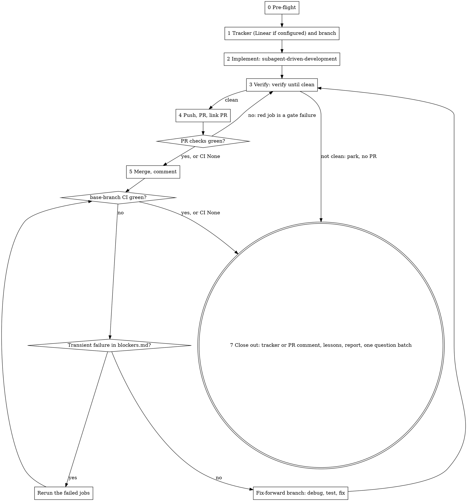

# Ship a plan

One run takes a written plan to a merged PR on a green base branch, tracked in
Linear when the repo configures it. **The user starts this skill so they can
walk away.** Every question you ask costs them a context switch. Each run
should need fewer questions than the last, and the repo's two logs are how that
happens.

**Before anything else, read the repo's `.claude/ship.md`
([format](config-format.md)), `.claude/ship/interruptions.md` and
`.claude/ship/blockers.md` in full.** The config holds every command and
setting for this repo. The first log holds standing answers to questions
earlier runs asked; the second holds the fixes for tooling that stopped earlier
runs. A question that has a standing answer is not asked again. Missing log
files are created from [log-formats.md](log-formats.md) at close-out.

## Guard

If the repo has `.claude/skills/ship-plan/`, stop: say "This repo has its own
ship skill; use `/ship-plan`." and do nothing else.

## What invoking this skill authorizes

Invoking the skill is the user's standing authorization, for this run, to:

- create the feature branch, commit, and push it (never with `--force`);
- open the PR, rerun failed CI jobs, and merge it once every check is green;
- open, push and merge follow-up branches that fix a red base branch caused by this run, including a revert PR;
- read and write the run's Linear issue — only when the config has `## Linear`: create it, assign it, set its status, edit its description, add links and comments;
- open, push and merge the docs-only lessons branch (section 8).

It does **not** authorize the following. Each goes into the question batch (section 3), never done on your own:

- a push to the base branch, `--force`, `--admin`, `--no-verify`, disabling a hook or a check;
- any deploy or production write;
- a write to a shared environment's data;
- deleting a branch, file or row you did not create;
- spending money (paid APIs, a paid service);
- editing Claude Code settings files or any skill's `allowed-tools`;
- everything under the config's `## Never do`.

The config can add to this list, never remove from it.

`superpowers:subagent-driven-development` and `verify` both say that a push, a
PR or a merge needs the user. Under this skill, the lists above replace that
rule.

**The frontmatter's `allowed-tools` pre-approves these commands** for the turn
that invoked the skill. They only match when written exactly as this skill
writes them:

- **every push names its branch:** `git push origin <branch>`. A bare `git push` is not pre-approved, and on the base branch it would push to it;
- merges: `gh pr merge <n> --squash --delete-branch`, or `--merge` when the config says `Merge: merge`;
- reruns: `gh run rerun <id> --failed`;
- reverts: `git revert --no-edit <sha>`;
- fetch, stage and commit (`git fetch origin <ref>`, `git add <files>`, `git commit`) are local and pre-approved. Run a fetch and a merge as two separate commands, never joined with `&&`.

Gate and prerequisite commands from the config are not pre-approved. In a
permission mode that prompts, list them in the pre-flight batch with the exact
allow lines (`Bash(<command>)`) for the user to add, so the run does not stall
on its first gate.

The pre-approval clears when the user sends a message. So every question you
ask ends with: **"Answer with `/ship <your answers>`,"** which starts the
skill again, renews the pre-approval, and resumes from the ledger. A command
still refused after that goes into the batch (section 5, step 4).

## The run

The run ends at section 7 and nowhere else. Waiting on CI is not an end, and
neither is a pending question when other work remains.

### The ledger

`.superpowers/ship/<branch>/ledger.md` (`.superpowers/` goes in
`.git/info/exclude`, never `.gitignore`). Its first line is always
`Phase: <n> | Issue: <id or none> | PR: #<n> | merge: <sha> | base run: <id>`,
rewritten as each value becomes known. Below it, one line per event: phase
changes, `Ruling:` lines, questions parked, CI results, `Lesson:` lines.
**After a context compaction, resume from this line and `git log`, not from
memory.** `questions.md` sits next to it (section 3). `verify` keeps its own
ledger in `.superpowers/verify/<branch>/`; link to it rather than copying from it.

## 0. Pre-flight

The user has just invoked the skill and is probably still there. This is the
cheapest moment to ask anything, and the last one until the end.

1. **Guard and config.** Run the guard. No `.claude/ship.md`: draft it ([config-format.md](config-format.md), "Drafting a missing config"). The draft goes at the top of the batch. Implementation proceeds; `verify` runs no gate until the user confirms the draft. An existing config is read by its reading rules: every unknown config section goes at the top of the batch, and a near-miss of `Never do`, `Fix rules` or `Security extras` is applied anyway and flagged.
2. **Resume or start.** If a ship ledger already exists for the current branch, this is a resumed run and the argument is answers: apply them to the parked questions, record each, and continue from the ledger's first line. Do not read the argument as a plan path.
3. **Resolve the plan.** A path; or a Linear id when Linear is configured (the issue description may be the plan; with Linear unavailable there is no plan, so park it and ask now). No argument: the newest file in `docs/superpowers/plans/`, recorded as a `Ruling:`.
4. **Check tools and auth, in parallel:** `gh auth status`; Linear `get_user("me")` when Linear is configured; `git fetch origin <base> --quiet`, then `git status --porcelain`. A dirty working tree that is not yours goes in the batch; never stash or discard it. **Linear configured but unavailable** (not connected, or the call fails): park "Linear unavailable: <exact error>" in the batch, continue as if Linear were not configured (the PR body carries the plan), and say so in the report. Never retry it through another route. **A Linear call that fails later in the run** gets the same rule; if the PR already exists, post its Plan section as a `gh pr comment`.
5. **Predict what the run will need from the user,** by reading the plan: every task marked `[needs a decision]`, "ask the user", "confirm", or open questions; hosted sign-ins for the config's `## UI testing`; anything on the "does not authorize" list.
6. **Answer what you can.** Apply every standing answer from `interruptions.md`, and decide every question the confidence test (section 3) allows. Record each as a `Ruling:` line.
7. **Ask the rest in one message** (ending with the `/ship` answer line), using `AskUserQuestion` (at most 4 questions; the recommended option first, marked "(Recommended)"). More than 4, or questions that need free text: one numbered message. Say that you'll continue with everything that doesn't depend on the answers. If nothing is left to ask, don't ask anything and start.

Do not wait for the answers. Start section 1 and every task that doesn't depend on them.

## 1. Tracker and branch

**Linear configured.** Team, project and statuses come from the config's
`## Linear`; follow its `Notes:`. Templates are in [templates.md](templates.md).

Find the issue, stopping at the first hit:

1. an id in the argument;
2. the team key followed by `-<n>` in the plan's header or "Source:" line;
3. the same in the current branch name;
4. `list_issues` with the configured team and a `query` built from the plan's title words. Consider only issues that are not in a done, canceled or duplicate state.

| Search result | Action |
|---|---|
| Exactly one issue that clearly matches | Use it. |
| Several plausible matches | Use the one whose description matches the plan's goal best. Record a `Ruling:`, and list the others in the report as possibly related. |
| None | Create one in the configured team and project ("Linear: new issue" in templates.md). |

Start the work: `save_issue` with `assignee: "me"` and `state: <Start status>`.
If the description does not already contain the plan, append it ("Linear: plan
appended"). Never overwrite what the user wrote.

Do not assume an integration closes the issue. You attach the PR and you set
the done status, only when the config's `Done means:` is met. If something sets
it earlier, leave the status alone while reruns or fixes are still running, so
it does not flip back and forth, and record a `Lesson:`: an integration now
closes issues, and the config's `Notes:` need correcting.

**Linear not configured.** No tracker step. The plan goes into the PR body
(templates.md, "PR body").

**Branch.** If you are on the base branch, create the branch from
`origin/<base>` in the current checkout (`git switch -c <name> origin/<base>`),
named by the config's `Branch:` pattern: `<type>/<slug>`, or `<type>/<id>-<slug>`
with an issue. `<type>` is `feature`, `fix`, `docs`, `chore` or `refactor`,
whichever fits the plan. `<slug>` is 3–6 words of the title in kebab case.
**Never use Linear's `gitBranchName`**: it starts with the user's name. Do not
create a worktree on your own: a fresh worktree lacks untracked files the repo
needs (dependencies, env files). If the current checkout is on another branch
or dirty, put it in the batch; never switch it. If you are already on a branch
for this plan, stay on it.

## 2. Implement

**REQUIRED SUB-SKILL:** superpowers:subagent-driven-development, on the branch from section 1. Four adjustments:

- **Its pre-flight concerns and rulings** follow its own "Rulings, not stalls" rule. Anything it would stop for goes into `questions.md` (section 3). The run goes on with the tasks that don't depend on it.
- **Before it deletes its workspace,** copy every `Ruling:` line from its `progress.md` into this ledger. They go to the user in the report and the closing comment.
- **Skip its last step,** `finishing-a-development-branch`. Its menu is the question this skill already answered. Go to section 4.
- **Every implementer dispatch carries the commit trailers verbatim,** with the words "copy them exactly; do not substitute your own model name". Implementers given the lines without that sentence have written their own trailer, and fixing it needs a force-push, which this skill never does.

## 3. Questions

Every time you'd want to ask the user something:

1. **Check `interruptions.md`.** If there is a standing answer, apply it and note `Ruling: standing answer <entry>`.
2. **Apply the confidence test.** Decide it yourself, with a `Ruling: <decision> — <evidence quoted> — <cost if wrong>` line, when **all four** hold:
   - the plan, the spec, the repo's agent instructions, a standing answer, or existing code points one way, and you can quote it;
   - a follow-up commit can undo it;
   - it is not in the "does not authorize" list;
   - it doesn't **widen** access or change money: nothing new becomes visible or allowed to a role, and nothing changes what a customer is charged. Those need the user, even if you are confident. **Narrowing access to what the spec already states,** through the repo's existing mechanism (its access-control layer, an existing role check), passes this part. It is a security fix, not a product decision. Pick the variant the codebase already uses for the same case, and quote that sibling.
3. **"Should we go beyond the spec?"** (widen a role, add a feature the spec leaves out) is not a question for this run. Rule for what the spec says, and list the alternative under Follow-ups in the closing comment.
4. **Otherwise, park it** in `questions.md`: the question, the options, your recommendation, and what is blocked by it. Then keep working on everything else.
5. **Ask only when nothing unblocked is left.** Then ask the whole of `questions.md` at once. The usual moment is the close-out (section 7). Mid-run, the only reason is that every remaining path is blocked, for example a denied merge with nothing else to do.

A failing gate, a red CI job, a flaky test, or a merge conflict is **work, not
a question.** `verify`'s section 6 stop conditions are parked here, not asked
on the spot, except for a destructive action.

## 4. Verify, push, PR

1. **REQUIRED SUB-SKILL:** `verify`. Run it until it reports `clean` or `clean before merge; N scenarios pending`. Its setup step collects its own questions; those go into `questions.md` unless blocked. Pending scenarios are listed in the ledger as **pending after merge**.
   `not clean: <reason>`: never push and never open the PR. A reason the loop can still work on (a gate failure, a review finding) is work: keep going. A reason that needs the user (an unconfirmed draft config, a gate that could not run, no gates, round 5, a fix that still fails) is parked in `questions.md`; when nothing unblocked is left, go to close-out (section 7) with no PR, and ask the batch. Never call `verify` again on an unchanged reason.
2. **Push:** `git push -u origin <branch>`.
3. **Open the PR:** `gh pr create --base <base>`. Title: the outcome in plain words, plus ` (<ID>)` when there is an issue. Body: templates.md, "PR body" (with its `## Plan` section when there is no Linear). It ends with the attribution line.
4. **Linear configured:** link the PR with `save_issue` and `links: [{url, title: "PR #n — <title>"}]`.
5. **Wait for checks:** `gh pr checks <n> --watch --fail-fast` with `run_in_background`. While waiting, draft the closing comments. If it answers "no checks reported":
   - **CI None** — the config's `## CI` says `None`, or `.github/workflows/` holds no workflow file: there is nothing to wait for. Record `CI: None` in the ledger and go to section 5. This is not a question: the repo has no CI, and `verify` clean is the gate.
   - Otherwise read each workflow's `on:` block: its `pull_request` trigger, branch filters and `paths` / `paths-ignore`. **No workflow covers this PR** (a docs-only diff under `paths-ignore`, a PR-only filter that excludes this base): there is no PR CI for this diff. Record "no PR CI for this diff", go to section 5, and say so in the report.
   - A workflow does cover it: CI has not registered yet. Wait up to 10 minutes, then treat it as a blocker: park it and close out with the PR open ("not merged").
6. **A red check:** `gh run view <run-id> --log-failed | tail -150`.
   - A transient failure listed in `blockers.md`: `gh run rerun <run-id> --failed`.
   - Anything else is a gate failure. Back to `verify`: fix it with a test first, run the gates, then run a review round unless the fix keeps behaviour. Commit, `git push origin <branch>`, and wait again.

## 5. Merge

1. `gh pr view <n> --json mergeable,mergeStateStatus,statusCheckRollup,reviewDecision`. Every check must be `SUCCESS` or `SKIPPED`. CI None, or no PR CI for this diff: there are no checks to read; `verify` clean is the gate. **`reviewDecision` is `REVIEW_REQUIRED` or `CHANGES_REQUESTED`, or `mergeStateStatus` is `BLOCKED` with every check green:** the repo needs a human approval. Never use `--admin`. Park "needs approval" and close out with the PR open ("not merged").
2. **Behind the base branch or conflicting:** fetch the PR branch first (`git fetch origin <branch>`): the user may already have pressed GitHub's "Update branch". Then `git fetch origin <base>`, and as a separate command `git merge origin/<base>` (a merge, not a rebase, so no force-push). Resolve conflicts. If the merge brought in changes to files this branch touches, rerun the gates whose paths the merge touched. `git push origin <branch>`, and go back to 4.5. If the push is refused as non-fast-forward and `git diff HEAD origin/<branch>` is empty, `git reset --keep origin/<branch>` adopts their merge; anything else is someone's work, so stop and look.
   **A check red only because the base branch is red** (the same test fails on the base branch's own run, from someone else's change): never merge red and never fix that here. Poll the base branch's runs in the background; once one is green, merge `origin/<base>` as above. Still red when nothing else is left: park it and close out with the PR open.
3. Merge with the configured method: `gh pr merge <n> --squash --delete-branch` (or `--merge`). Record the merge SHA: `gh pr view <n> --json mergeCommit --jq .mergeCommit.oid`. `--delete-branch` also switches the local checkout to the base branch and deletes the local feature branch; continue from there (sections 6–8 branch from `origin/<base>`), and read this run's ledger by its path, since the branch it is named after is gone.
4. **The merge is refused** by the permission system, or by GitHub (a disallowed merge method, a branch policy): do not retry it, and do not try another route. It is now blocking, so ask the whole batch now. For a permission refusal, record it as a `Lesson:` proposing the exact `allowed-tools` line; section 8 writes the `interruptions.md` entry, so the next run is not refused.
5. **Linear configured:** comment "Merged" (templates.md). Do not set the done status yet.

## 6. Base-branch CI

CI None: skip this section and record "base branch has no CI".

1. Find the push run: `gh run list --workflow=<config Workflow> --branch=<base> --commit <sha> --json databaseId,status` (no `Workflow:` configured: `gh run list --branch <base> --commit <sha> --json databaseId,status,workflowName`, and watch every run). It may take a few seconds to appear. **No run for `<sha>` within 5 minutes** (the workflows do not run on pushes, or their path filters exclude this commit): record "no base-branch run for `<sha>`", treat it like CI None for this merge, and say so in the report. Otherwise `gh run watch <id> --exit-status` with `run_in_background`. If it exits 1, check `gh run view <id> --json status,conclusion` before calling the run red: `gh run watch` also exits 1 on a transient GitHub API error while the run carries on.
2. **Green**, as the config's `Green:` defines: go to 7.
3. **Red:** `gh run view <id> --log-failed | tail -150`, then classify:
   - **Transient, listed in `blockers.md`:** `gh run rerun <id> --failed`, then watch again. Up to 3 reruns. Before the 2nd and 3rd, wait 10 and then 20 minutes: run `sleep 600` (then `sleep 1200`) with `run_in_background`, and rerun when it finishes. Keep the rerun a separate command, so it matches the pre-approval. After the 3rd, park it in `questions.md` and go on to close-out; the work is not done.
   - **A new transient** (an external service down, a registry, the network, and the same step passed on the PR): treat it as above, then add it to `blockers.md` at close-out.
   - **Real:** fix forward. `git switch -c fix/<id-or-slug>-base-after-<pr> origin/<base>`. Find the root cause (superpowers:systematic-debugging), write a failing test, fix, run `verify` on this branch, then do sections 4–6 again with the title "Fix <base> after #<n>: <what>".
   - **The root cause isn't found in one attempt,** or the fix is not small: revert instead. A squash merge is an ordinary commit, so run `git revert --no-edit <merge sha>` on a new branch `fix/revert-<pr>` from `origin/<base>` (no `-m`), PR it, and merge it through the same loop. Linear configured: back to the start status, with the failure in a comment. Park the question of how to reland it.
4. **At most 3 fix-forward cycles** in one run. After that, stop fixing: the base branch is red, and that is the first line of the report and of the question batch.

While a deploy step on the base branch is red, what it deploys may be
half-updated. Say so in the closing comment until it is green.

## 7. Close out

1. **The config's `## After merge` checks,** read-only.
2. **Closing comment.**
   Three outcomes, one template each (templates.md):
   - **Done:** merged, and the base branch green, or no CI (CI None, no base-branch run for the merge). Linear configured: "Linear comment: done", then `save_issue` with the done status, **only when `Done means:` is met** (with CI None, Done means is "merged"). Not configured: `gh pr comment <n>` with "PR comment: done".
   - **Base branch red:** merged, and the base branch still red. "Linear comment: base branch red" or "PR comment: base branch red"; the issue stays in the start status.
   - **Not merged:** the PR is still open (verify not clean, checks never registered, the base branch red before merge, a refused merge, an approval required), or no PR exists. "Linear comment: not merged" or "PR comment: not merged"; with no PR and no Linear, the report is the only record.
3. **Lessons** (section 8).
4. **Report,** concise, in this order:
   1. **Needs you:** the batch.
   2. Status: base branch green or red (or "no CI"), PR, merge SHA, the issue link if any.
   3. Gate and scenario tables (from `verify`), and every unknown config section.
   4. **Decisions made for you:** every `Ruling:`, each with what it costs if wrong.
   5. **Not tested:** what, and why.
   6. The lessons recorded, and any proposed skill change.
5. **Ask the batch once,** after the report, with `AskUserQuestion` when the answers are choices. When the user answers, carry on: run the pending scenarios once they have signed in, add a new tracker or PR comment, and record each answer in `interruptions.md`.

## 8. Lessons

At close-out, before the report, on a branch from `origin/<base>`
(`docs/ship-lessons-<yyyy-mm-dd>`), never on the feature branch:

- **Every question you asked this run** (pre-flight, mid-run, final) becomes an `.claude/ship/interruptions.md` entry. When the user answers, fill in the answer and a **standing answer**: the rule that lets the next run decide on its own.
- **Every ruling the user overturned** becomes an entry too. That is how the confidence test gets calibrated.
- **Every tooling blocker** you got past goes into `.claude/ship/blockers.md`, in its format.
- Create either file from [log-formats.md](log-formats.md) if it is missing.
- **Config changes the user approved** go into `.claude/ship.md` on the same branch.
- **Lessons about the loop itself** (a missing step, a wrong order, a rule that misfired) go in the report as "proposed skill change", with the exact text. Never edit `~/.claude/skills/` on your own: those files are shared by every repo and not in git.
- **Batch empty:** open a docs-only PR, merge it through sections 4–6, and link it in the report.
- **Batch not empty:** commit and push the branch with those entries marked `Answer: pending` *before* you ask, so the lessons survive if the session ends. When the answers come, fill them in, then open the PR and merge it the same way.

During the run, write lessons in the ledger as `Lesson:` lines. Editing the
log files on the feature branch mixes them into the product PR.

## Red flags

| Thought | Reality |
|---|---|
| "I'll ask about the merge / the rerun / the follow-up PR" | The authorization section covers these. Do them. |
| "Quick question, then I'll carry on" | Park it. Ask the batch when nothing unblocked is left. |
| "I'm fairly sure, but I'll check with the user" | Run the confidence test. If it passes, rule and record. |
| "Set it to In Review" | Use only the statuses the config names. |
| "Linear already says done, fine" | Done means the config's `Done means:`. Check the base-branch run first. |
| "The PR is merged, so I'm done" | The run ends when the base branch is green, the closing comment is written, and lessons are recorded. |
| "The base branch failed, probably flaky, rerun until it passes" | Only a failure listed as transient gets a rerun, and at most 3. Anything else gets a root cause. |
| "Push the fix straight to the base branch, it's one line" | Never push to the base branch. A fix branch goes through the same loop. |
| "The ruling is obvious, no need to write it down" | An unrecorded ruling is a decision made in secret. Write the ledger line. |
| "I'll update interruptions.md next time" | Next time is when it would have saved the question. Do it at close-out. |
| "Use a worktree for isolation" | A fresh worktree lacks the repo's untracked files. Use the current checkout; put a busy checkout in the batch. |
| "No Linear here, so I'll just note it in chat" | The PR is the record. Plan, rulings and verification go in its body. |
| "'No checks reported', I'll keep waiting" | No workflows means CI None. Otherwise 10 minutes, then park. |
| "No checks is not the same as checks passing, so I can't merge" | With CI None, `verify` clean is the gate. The repo has no CI to pass; merge and report "base branch has no CI". |
| "Linear failed, I'll work around it some other way" | Park "Linear unavailable", continue without it, and say so in the report. |
