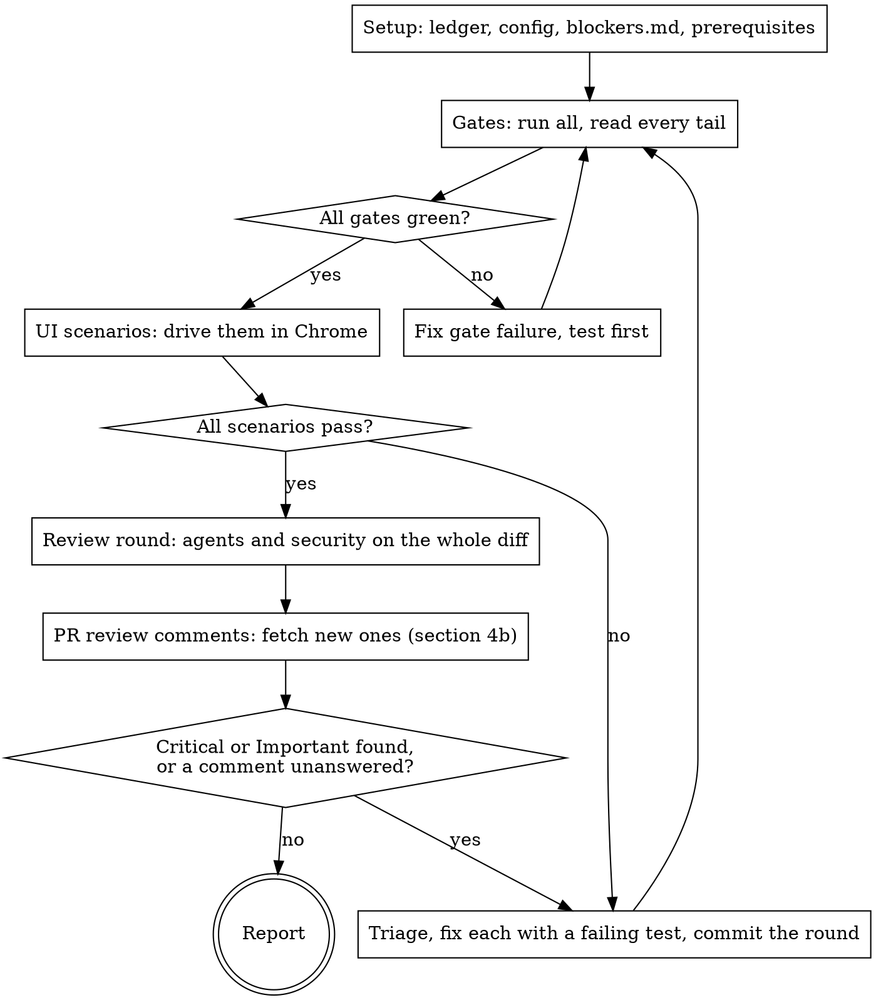

# Verify and fix

Run the loop yourself until it is clean: **every gate green, every UI scenario
passing, every PR review comment answered, AND a review round (security
included) that finds no Critical or Important issue.** The user started this skill so they
would not have to push each round. Rounds are not progress reports; do not stop
between them to ask whether to go on.

**Before round 1, read the repo's `.claude/ship-plan.md`
([format](../ship-plan/config-format.md)) and `.claude/ship-plan/blockers.md` in full.**
The config is the only source of commands. The blockers file is the list of
things that stopped earlier runs, and the fix for each. Reading it costs a
minute; rediscovering an entry costs an hour.

## The loop

A fix goes back through the gates **and** a fresh review round. Fixes cause
regressions: a later round often finds bugs an earlier round's fixes introduced.

## 1. Setup

- **Ledger:** `mkdir -p .superpowers/verify-and-fix/<branch>`, then `ledger.md` there. If `.superpowers/` is not listed in `.git/info/exclude`, append it there; never edit the repo's `.gitignore`. One line per round: the gate results, the findings with their grades, the fixes with their commits, and every `Ruling:` you made. After a context compaction, trust the ledger and `git log` over memory.
- **Base:** `<base>` is a branch name: `$ARGUMENTS`, else the config's `Base branch:`, else the repo's default branch from `gh repo view`. Run `git fetch origin <base> --quiet` first; every diff below compares `origin/<base>...HEAD`. If `git rev-parse --verify --quiet origin/HEAD` prints nothing (common in a fresh clone), run `git remote set-head origin --auto`: the `security-review` skill diffs against `origin/HEAD` and fails without it. It changes local git metadata only.
- **Config:**
  - Read `.claude/ship-plan.md` by its reading rules: headings match case-insensitively; a heading that matches no known section is **unknown**. Its rows never run, and the report names it.
  - **No config:** draft one ([config-format.md](../ship-plan/config-format.md), "Drafting a missing config") and write it to `.claude/ship-plan.md`. Put it at the top of the question batch with each gate's source. **Run no gate until the user confirms it.** Do the review round meanwhile. A draft lives in the repo, not in a scratch note: it is what the next run reads. Run on its own, leave the draft uncommitted and say so; under `ship-plan`, ship-plan commits it once confirmed.
  - The config is the single list of gates. If the repo's agent instructions or a Makefile name a check the config lacks, do not run it: propose adding it to the config.
- **Ask for everything only the user can provide, in one message, now:** hosted sign-ins, secrets the config names, the draft config. Then carry on with everything that does not wait on them. Asking in the middle of the loop costs the user a second interruption.
- **Prerequisites:** run the config's `## Prerequisites` rows in order, wait for each one's "Ready when", and start background rows with `run_in_background`. Stop them with TaskStop when the loop ends.

## 2. Gates

- Run every `## Gates` row whose `Only when changed` globs match `git diff --name-only origin/<base>...HEAD` (no globs: always). Run each with `CI=true` in its environment and its output sent to `.superpowers/verify-and-fix/<branch>/<gate>.log`, then read the tail. Long output left in context crowds out the rest of the loop.
- Run the command **exactly as configured.** A variant you think is better (an extra flag, a one-shot form) is a proposed config change, not something you run as the gate.
- Each gate has one result: **pass, fail, skipped, or could not run.** Read the tail for skip counts. Any skipped test or suite beyond the row's `Allowed skips` makes the gate "skipped", never pass; skips within it are a pass, noted in the gate table.
- **Timeout:** the row's `Timeout`, else 20 minutes. Run the gate in the background and check it; at the limit, stop it. The result is "could not run: <reason>", for example "watch mode, never exits". Propose a one-shot command as a config change, and go on with the other gates.
- **Could not run** (no prerequisite, timeout, missing tool): keep running the other gates and the review rounds, but the loop cannot end as clean. The report names the gate, why it could not run, and what the user has to do.
- **No gates configured:** the loop cannot end as clean. Say so in the question batch.

**CI, read-only.** When the branch has an open PR, its checks are a gate too:
`gh pr checks <n>`, then `gh run view <run-id> --log-failed | tail -150` for any
red job. A red job is a gate failure: fix it locally with a test first, and
propose the job's check as a config gate if the config lacks it. Pushing the
fix to the PR's branch is authorized (section 4b).

**UI scenarios are a gate too** whenever the diff touches the config's
`User-visible paths:`. **REQUIRED: read [ui-testing.md](ui-testing.md)** and
drive the scenarios yourself.

## 3. UI scenarios

When `## UI testing` is configured and the diff touches its user-visible paths,
follow [ui-testing.md](ui-testing.md). When it is not configured, or the app
cannot be reached, and the change is something a user can see or trigger, the
scenarios go in the report's **Not tested** section. Never ask the user to
click through.

## 4. Review round

Scope: `git diff origin/<base>...HEAD`. Launch these in parallel, each on the
whole diff, each with the `model` and `effort` of the config's `## Models`
`Review round` row ([format](../ship-plan/config-format.md); default `opus`,
`high`) passed explicitly. Agents whose definition says `model: inherit` would
otherwise take whatever model the session runs on.

- Always: `pr-review-toolkit:code-reviewer` and `pr-review-toolkit:silent-failure-hunter`.
- When tests changed: `pr-review-toolkit:pr-test-analyzer`. When comments or docs changed: `pr-review-toolkit:comment-analyzer`. When types were added: `pr-review-toolkit:type-design-analyzer`.
- The agents from the config's `## Reviewers by path` whose globs the diff touches.
- **Security, every round:** run the `security-review` skill on the branch. Check these yourself too, because no gate does:
  - **Authorization:** every new endpoint, route, handler or RPC checks who calls it, the same way its siblings do. Quote the sibling.
  - **Tenancy and ownership:** every new query that reads or writes user data is scoped to the caller the way existing queries are.
  - **Input:** no query built by string concatenation; no untrusted input in raw HTML, a URL, a file path, a shell command or an object key without validation.
  - **Secrets:** nothing added to code, a committed file, a client bundle, a log line or an error message.
  - **Webhooks:** the signature is verified before the body is used.
  - **Dependencies:** each new dependency is reviewed (maintainer, adoption, install scripts). The config may add an audit gate.
  - The config's `## Security extras`.
  A security finding that exposes data or lets a role do more than it should is Critical, and it is not re-graded down.

**Copied code, every round.** For each file the diff adds that copies another
file in the repo (a second service's setup, a test fixture, a helper), diff it
against its source. A CI duplication gate (Sonar's "Duplicated Lines on New
Code", 3% by default) fails the PR on a shared block that no local gate
catches, and finding it after the push costs a CI round and a question. A shared
block of more than about 30 lines is an Important finding: extract it the way
the repo's agent instructions say, or, when the plan copies on purpose, put it
in the question batch with the extraction as the recommended option.

**Then look for other copies of the same source.** Another branch may have
copied it into the same place under another name: on ORIG-8202, #124 and #126
each added a Serilog capture sink to Onboarding's tests (`CapturingSink.cs` and
`SerilogCapture.cs`), and neither saw the other. For each copied source, take
two or three names only it declares (types, members, configuration keys), then:

- `git grep -n -e <name> … origin/<base> -- <the folder the copy goes in>`: a hit outside this diff is a copy already on the base branch. Reuse it instead of adding a second one, or merge the two in this PR.
- `gh pr list --state open --json number,files --jq '.[] | select(any(.files[]; .path | startswith("<that folder>/"))) | .number'`, then `gh pr diff <n> | grep -n -e <name>` for each PR it lists: a hit is a copy in flight. Name it in the report, with both paths, so whichever PR merges second reuses the other's copy. Commenting on the other PR is outward-facing: it goes in the question batch, never done on your own.

Run this again each time the base branch is merged into this branch: the
merge is where a copy from a PR that merged first arrives. A second copy is a
Suggestion (Important when it crosses the duplication gate's threshold), fixed
in this PR when it keeps behaviour, and otherwise a follow-up named in the
report.

Give each reviewer the ledger's `Ruling:` lines, so settled questions are not
raised again as new findings.

**If a reviewer agent or the `security-review` skill is unavailable,** do its
review yourself against the same checklist, and mark it "self-review" in the
ledger and the report.

**A round is one review round.** Fixing a gate failure does not start a new
round. The round count is what the round-5 limit in section 6 counts.

## 4b. PR review comments

When the branch has an open PR (`gh pr view --json number,url,reviewDecision`),
its review comments are findings too, from people and from Copilot. Every
round, after the agents, fetch the ones not handled yet. Invoking this skill on
a branch with an open PR authorizes, for that PR only: committing, `git push
origin HEAD` while the PR's head branch is checked out (never `--force`, never
on the base branch), replying in its threads, resolving
Copilot's threads, and re-requesting a review (below). Never approve, dismiss a
review, resolve a person's thread, merge, or request a new reviewer.

`<o>/<r>` is `gh repo view --json nameWithOwner --jq .nameWithOwner`; your
login is `gh api user --jq .login`. Run each once.

**Fetch.**

- Threads: `gh api graphql -f query='query ReviewThreads($owner:String!,$name:String!,$n:Int!){repository(owner:$owner,name:$name){pullRequest(number:$n){reviewThreads(first:100){nodes{id isResolved isOutdated path line comments(first:50){nodes{id author{login} body createdAt}}}}}}}' -F owner=<owner> -F name=<repo> -F n=<n>`
- Review bodies and conversation comments: `gh pr view <n> --json reviews,comments`.

**What counts as new.** Every item is keyed by GraphQL node ids (the `id`
fields above, which `gh pr view` also returns); the ledger records
`Review: <key> <author> <grade> — <one line> — <action>`.

| Item | Key | New when |
|---|---|---|
| Inline thread | `thread <thread id> @ <last comment id>` | Unresolved, its last comment is not yours, and the ledger has no line for this key. A reviewer's reply in a handled thread changes the last comment, so it is new. |
| Review body | `review <review id>` | Its body is not empty, whatever its state (an approval can carry a request), and the ledger has no line for this key. **Not** Copilot's summary review: its findings arrive as threads. |
| Conversation comment | `comment <comment id>` | Not yours, not from a bot other than Copilot (CI, coverage and the Jira integration are not reviewers), and the ledger has no line for this key. |

Copilot's login shows as `Copilot` or `copilot-pull-request-reviewer`, with or
without `[bot]`. Read each item with the code it points at, at `HEAD`: an
outdated thread may already be fixed. Then grade it in section 5 with the
agents' findings, by the same rules: a comment is right or wrong on its merits,
not by who wrote it.

**Reply** to every item once its fix is pushed (templates in ship-plan's
[templates.md](../ship-plan/templates.md), "Review reply"; write the body to a
file in the ledger directory and pass it with `-F body=@<file>`):

- an inline thread: `gh api graphql -f query='mutation ReplyToThread($id:ID!,$body:String!){addPullRequestReviewThreadReply(input:{pullRequestReviewThreadId:$id,body:$body}){comment{id}}}' -f id=<thread id> -F body=@<file>`;
- a review body or a conversation comment: `gh pr comment <n> --body-file <file>`, quoting the start of what you answer;
- **resolve** a Copilot thread once it has a reply of any kind (fixed, answered, follow-up, not valid): `gh api graphql -f query='mutation ResolveThread($id:ID!){resolveReviewThread(input:{threadId:$id}){thread{isResolved}}}' -f id=<thread id>`. A person's thread is theirs to resolve.
- **Re-request** a person with `gh pr edit <n> --add-reviewer <login>` when every change they requested is addressed, or when your push dismissed their approval (their latest review turned `DISMISSED`). Never re-request Copilot: a ruleset that wants it re-reviews on push by itself.

Record each reply as `Replied: <key> — <fixed in <sha> | answered | follow-up | not valid | needs a decision>`.

**Jira.** When the branch name carries a Jira issue key and the config has
`## Jira`, post ship-plan's "Jira comment: review round" after the replies
(`cloudId` is its `Site:`). Under `ship-plan`, skip it: ship-plan posts it.

**`--comments` mode** (how `ship-plan` calls this skill while a PR waits for
review): the PR's comments are the only new findings. Run 4b and section 5 on
them, then the gates. Run a review round only when a fix changes behaviour, and
then only on the fix commits (`git diff <commit before the fixes>..HEAD`), not
the whole branch: reviewers already saw the rest. A red PR check is a finding
in this mode too. The round count starts at 1 on each call. **Clean in this
mode:** every gate passed, every comment has a reply and none graded "needs
the user" is undecided, and the fix-diff round, if one ran, found no Critical
or Important issue.

## 5. Triage and fix

Grade each finding by what a user would get if it shipped, not by the label the
reviewer put on it.

| Grade | Action |
|---|---|
| Critical, Important | Fix this round. Write a test that reproduces the finding, watch it fail, then fix. Important includes anything a user sees wrongly: raw error text, a refused write that reads as saved, missing or untranslated text, silently dropped data. |
| Suggestion | Fix if it keeps behaviour and stays in scope. Otherwise list it in the report. **A PR comment from someone who has not approved, while the PR has approvals:** reply that it is a follow-up and don't push it, because a push can dismiss the approvals ("Follow-up while approved" reply). **An approver's own request** is their condition, not a follow-up: fix it, push, and re-request them. |
| Question (PR comment) | A request for information: answer it, quoting the code. A question that proposes a change ("why not use the existing helper?") is a Suggestion: if the proposal fits, make it; if not, say why. |
| Not a real issue | Write a `Ruling:` quoting the code that proves it. Without a quote, it is a finding. A PR comment also gets a reply with that quote. |
| Needs the user (PR comment) | A product decision, widened access, money, or beyond the spec (section 6). Reply that it needs the author's decision, and stop on it as section 6 says. |
| Outside the diff | List it in the report. Do not widen the branch. A PR comment also gets a reply naming it as a follow-up. |

When a round's only fixes are behaviour-keeping suggestions (a rename, a comment,
dead code), rerun the gates, but not a review round. Every other fix gets both.

Fix rules: the config's `## Fix rules`, plus: never weaken or delete a test to
make it pass; never change an expected value without a separately justified
reason. Commit once per round for the agents' findings, and **once per PR
comment** for review fixes (`fix(review): <what>`), so each reply can name its
commit. Stage only the files you fixed, by name (never `git add -A`, which
sweeps in logs and drafts), and let the repo's hooks run (never
`--no-verify`). With an open PR, push once the round's gates pass, then reply
(section 4b).

## 6. When to stop and ask

Only these stop the loop:

- **Signing in on a hosted URL:** ask once for every role you need (ui-testing.md). Local URLs you sign in to yourself.
- **An action that is outward-facing or destructive:** a push without an open
  PR, opening a PR, merge, any write to a shared environment or production,
  deleting anything you did not create. (Pushing and replying on an open PR are
  covered by section 4b.) Hand the user the exact command in one copyable block, then continue
  once it is done. (Under `ship-plan`, its authorization list covers push, PR and merge.)
- **Anything under the config's `## Never do`.** Same handling as above.
- **A finding that needs a product decision**, where two reasonable behaviours
  conflict and the spec does not settle it.
- **A fix whose test still fails** after one root-cause attempt
  (superpowers:systematic-debugging). Report what you tried.
- **Round 5 still has Critical or Important findings.** The design is likely
  wrong, and more patching will not help.

A failing gate is not a reason to stop. It is the loop's input.

Waiting on the user is not the same as stopping. Keep doing everything that
does not depend on the answer. When nothing is left, end with the report, and
put what is pending at the top of it.

## 7. Report

**What "clean" means.** Clean: every gate passed, every scenario passed, every PR
review comment has a reply, and the last review round found no Critical or
Important issue. When some scenarios
could not run locally (the config or the environment could not provide them)
and were deferred, the status is **"clean before merge; N scenarios pending"**.
Name those scenarios, and never call that result clean. Anything else is
**"not clean: <reason>"**. The status line uses exactly one of these three forms.

**Everything that was not tested gets its own section at the end of the
report**, with the scenarios, what was missing, and whether the user declined
to provide it. A third-party flow without test credentials is the usual case.
A check the reader cannot see was skipped is worse than a failing one.

Keep it short: the gate table (pass / fail / skipped / not run, with the
reason), the scenario table from `scenarios.md` with the paths to the GIFs, how
many rounds ran, the fixes with their commits, the PR review items (author,
grade, result, reply) when there is a PR, every `Ruling:`, the suggestions
listed rather than fixed, the blockers entries added this run, every unknown
config section, and every proposed config change.

## 8. Self-improvement

Whenever something blocks you (a command that will not run, a hook refusal, a
tool that misbehaves, a gate that lies) and you get past it, **update
`.claude/ship-plan/blockers.md` in the same session, before the report.** Create it
from [log-formats.md](../ship-plan/log-formats.md) if it is missing. Under `ship-plan`, record it as a `Lesson:` line in
ship-plan's ledger instead of editing the file: ship-plan's section 8 writes it on its
lessons branch, so it never lands in the product PR.

- Add an entry: the symptom (exact error text), the cause, the fix (the exact
  command), and the date.
- If an existing entry was wrong or out of date, correct it rather than adding a
  second one.
- If the lesson changes how the loop runs (a missing step, a reviewer to add, a
  step in the wrong order), propose the change to this skill in the report.
  Never edit this skill's files silently: every repo uses them, and they are
  published from their own git repository.
- A missing gate or reviewer: propose the `.claude/ship-plan.md` change in the report.
- If the lesson is a rule for the whole repo rather than for this loop, propose
  a change to the repo's agent instructions file in the report. Do not edit it
  on your own.

Run on its own, leave these edits uncommitted and say so. Under `ship-plan`, they go
to its lessons PR as `Lesson:` lines.

A blocker you got past but did not write down will stop the next run too.

## Red flags

| Thought | Reality |
|---|---|
| "The suite passed" (some of it skipped) | A skipped test is a check that did not run. Say so. |
| "The reviewer called it minor" | Re-grade it by what the user gets. |
| "Copilot is a bot, its comments don't matter" | Grade every comment on its merits. A bot can be right. |
| "The reviewer is wrong, I'll ignore it" | Reply with the quoted evidence. Every comment gets an answer. |
| "I'll resolve their thread so the PR can merge" | Only Copilot's threads. A person resolves their own. |
| "It's approved, one more suggestion won't hurt" | A push can dismiss the approval. Reply "follow-up" instead, unless the suggestion is an approver's own request: that one you fix. |
| "That was fixed last round" | A fix gets a fresh review. Fixes cause regressions. |
| "I'll note the blocker later" | Write the blockers entry now, or it is lost. |
| "The unit tests pass, so the flow works" | Drive it in Chrome. Suites pass and flows still break in the UI. |
| "The user can click through it faster" | The user started this skill so they would not have to. Drive it yourself. |
| "The toast said saved" | Check the network response and reload. A toast over a 403 is a failed scenario. |
| "It's not security-sensitive" | Run the security review anyway. Tenancy leaks look like ordinary queries. |
| "I'll keep looping until it's perfect" | Stop at clean gates plus a clean review round, or at round 5. |
| "The repo obviously uses this tool, I'll just run it" | Only configured gates run. Propose the gate as a config change. |
| "Nobody asked me to add repo config, I'll keep the gate list in a scratch note" | No config means draft `.claude/ship-plan.md`, ask once, and run no gate until it is confirmed. |
| "I'll rerun the gate with a better flag" | Run it as configured. A better command is a proposed config change. |
| "It's still running, I'll give it a bit longer" | The timeout is the timeout. Stop it, record "could not run", move on. |
| "The config heading is misspelled but I know what it means" | Match case-insensitively. Anything else is an unknown section: its rows do not run, and the report names it. |
| "The agent instructions list more checks, I'll run them too" | The config is the single gate list. Propose the missing check. |
