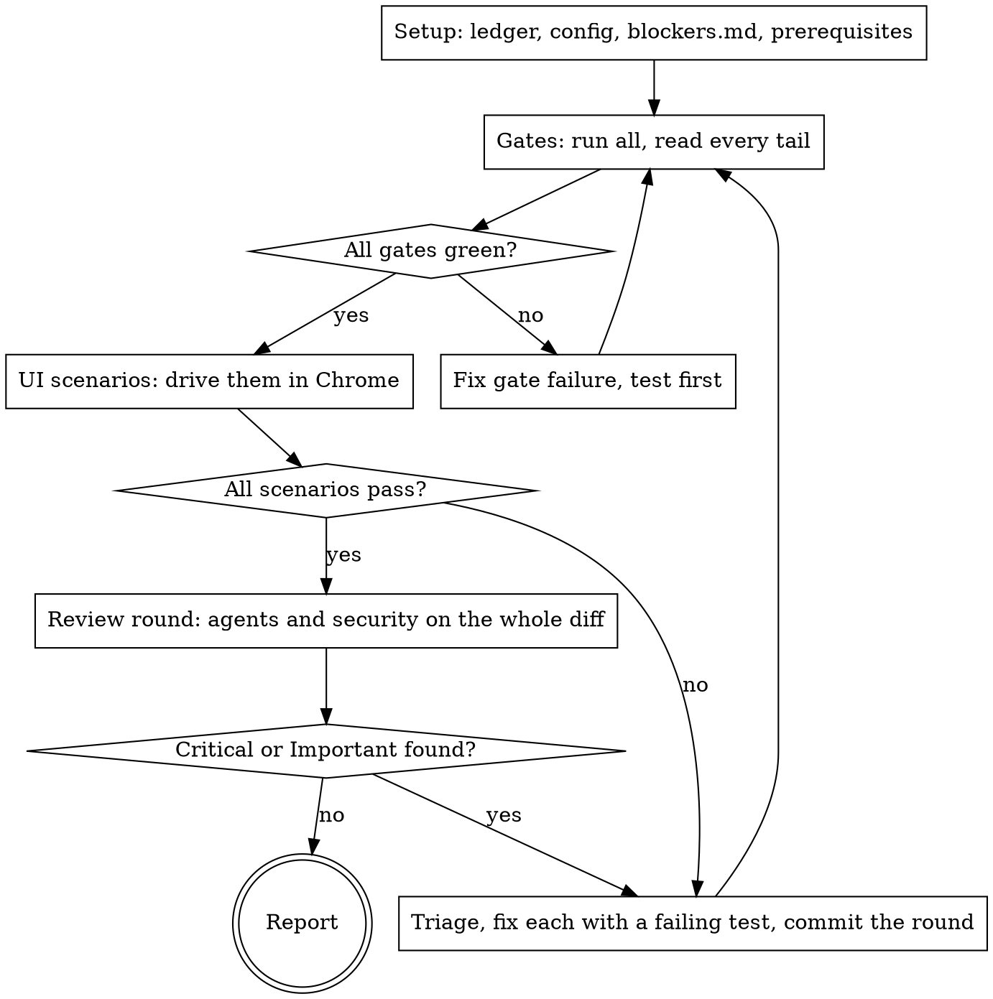

# Verify and fix

Run the loop yourself until it is clean: **every gate green, every UI scenario
passing, AND a review round (security included) that finds no Critical or
Important issue.** The user started this skill so they
would not have to push each round. Rounds are not progress reports; do not stop
between them to ask whether to go on.

**Before round 1, read the repo's `.claude/ship.md`
([format](../ship/config-format.md)) and `.claude/ship/blockers.md` in full.**
The config is the only source of commands. The blockers file is the list of
things that stopped earlier runs, and the fix for each. Reading it costs a
minute; rediscovering an entry costs an hour.

## Guard

If the repo has `.claude/skills/verify-and-fix/`, stop: say "This repo has its
own verify skill; use `/verify-and-fix`." and do nothing else.

## The loop

A fix goes back through the gates **and** a fresh review round. Fixes cause
regressions: a later round often finds bugs an earlier round's fixes introduced.

## 1. Setup

- **Ledger:** `mkdir -p .superpowers/verify/<branch>`, then `ledger.md` there. If `.superpowers/` is not listed in `.git/info/exclude`, append it there; never edit the repo's `.gitignore`. One line per round: the gate results, the findings with their grades, the fixes with their commits, and every `Ruling:` you made. After a context compaction, trust the ledger and `git log` over memory.
- **Base:** `<base>` is a branch name: `$ARGUMENTS`, else the config's `Base branch:`, else the repo's default branch from `gh repo view`. Run `git fetch origin <base> --quiet` first; every diff below compares `origin/<base>...HEAD`. If `git rev-parse --verify --quiet origin/HEAD` prints nothing (common in a fresh clone), run `git remote set-head origin --auto`: the `security-review` skill diffs against `origin/HEAD` and fails without it. It changes local git metadata only.
- **Config:**
  - Read `.claude/ship.md` by its reading rules: headings match case-insensitively; a heading that matches no known section is **unknown**. Its rows never run, and the report names it.
  - **No config:** draft one ([config-format.md](../ship/config-format.md), "Drafting a missing config") and write it to `.claude/ship.md`. Put it at the top of the question batch with each gate's source. **Run no gate until the user confirms it.** Do the review round meanwhile. A draft lives in the repo, not in a scratch note: it is what the next run reads. Run on its own, leave the draft uncommitted and say so; under `ship`, ship commits it once confirmed.
  - The config is the single list of gates. If the repo's agent instructions or a Makefile name a check the config lacks, do not run it: propose adding it to the config.
- **Ask for everything only the user can provide, in one message, now:** hosted sign-ins, secrets the config names, the draft config. Then carry on with everything that does not wait on them. Asking in the middle of the loop costs the user a second interruption.
- **Prerequisites:** run the config's `## Prerequisites` rows in order, wait for each one's "Ready when", and start background rows with `run_in_background`. Stop them with TaskStop when the loop ends.

## 2. Gates

- Run every `## Gates` row whose `Only when changed` globs match `git diff --name-only origin/<base>...HEAD` (no globs: always). Run each with `CI=true` in its environment and its output sent to `.superpowers/verify/<branch>/<gate>.log`, then read the tail. Long output left in context crowds out the rest of the loop.
- Run the command **exactly as configured.** A variant you think is better (an extra flag, a one-shot form) is a proposed config change, not something you run as the gate.
- Each gate has one result: **pass, fail, skipped, or could not run.** Read the tail for skip counts. Any skipped test or suite beyond the row's `Allowed skips` makes the gate "skipped", never pass; skips within it are a pass, noted in the gate table.
- **Timeout:** the row's `Timeout`, else 20 minutes. Run the gate in the background and check it; at the limit, stop it. The result is "could not run: <reason>", for example "watch mode, never exits". Propose a one-shot command as a config change, and go on with the other gates.
- **Could not run** (no prerequisite, timeout, missing tool): keep running the other gates and the review rounds, but the loop cannot end as clean. The report names the gate, why it could not run, and what the user has to do.
- **No gates configured:** the loop cannot end as clean. Say so in the question batch.

**CI, read-only.** When the branch has an open PR, its checks are a gate too:
`gh pr checks <n>`, then `gh run view <run-id> --log-failed | tail -150` for any
red job. A red job is a gate failure: fix it locally with a test first, and
propose the job's check as a config gate if the config lacks it. Pushing the
fix needs the user (section 6), or `ship`.

**UI scenarios are a gate too** whenever the diff touches the config's
`User-visible paths:`. **REQUIRED: read [ui-testing.md](ui-testing.md)** and
drive the scenarios yourself.

## 3. UI scenarios

When `## UI testing` is configured and the diff touches its user-visible paths,
follow [ui-testing.md](ui-testing.md). When it is not configured, or the app
cannot be reached, and the change is something a user can see or trigger, the
scenarios go in the report's **Not tested** section. Never ask the user to
click through.

## 4. Review round

Scope: `git diff origin/<base>...HEAD`. Launch these in parallel, each on the whole diff:

- Always: `pr-review-toolkit:code-reviewer` and `pr-review-toolkit:silent-failure-hunter`.
- When tests changed: `pr-review-toolkit:pr-test-analyzer`. When comments or docs changed: `pr-review-toolkit:comment-analyzer`. When types were added: `pr-review-toolkit:type-design-analyzer`.
- The agents from the config's `## Reviewers by path` whose globs the diff touches.
- **Security, every round:** run the `security-review` skill on the branch. Check these yourself too, because no gate does:
  - **Authorization:** every new endpoint, route, handler or RPC checks who calls it, the same way its siblings do. Quote the sibling.
  - **Tenancy and ownership:** every new query that reads or writes user data is scoped to the caller the way existing queries are.
  - **Input:** no query built by string concatenation; no untrusted input in raw HTML, a URL, a file path, a shell command or an object key without validation.
  - **Secrets:** nothing added to code, a committed file, a client bundle, a log line or an error message.
  - **Webhooks:** the signature is verified before the body is used.
  - **Dependencies:** each new dependency is reviewed (maintainer, adoption, install scripts). The config may add an audit gate.
  - The config's `## Security extras`.
  A security finding that exposes data or lets a role do more than it should is Critical, and it is not re-graded down.

Give each reviewer the ledger's `Ruling:` lines, so settled questions are not
raised again as new findings.

**If a reviewer agent or the `security-review` skill is unavailable,** do its
review yourself against the same checklist, and mark it "self-review" in the
ledger and the report.

**A round is one review round.** Fixing a gate failure does not start a new
round. The round count is what the round-5 limit in section 6 counts.

## 5. Triage and fix

Grade each finding by what a user would get if it shipped, not by the label the
reviewer put on it.

| Grade | Action |
|---|---|
| Critical, Important | Fix this round. Write a test that reproduces the finding, watch it fail, then fix. Important includes anything a user sees wrongly: raw error text, a refused write that reads as saved, missing or untranslated text, silently dropped data. |
| Suggestion | Fix if it keeps behaviour and stays in scope. Otherwise list it in the report. |
| Not a real issue | Write a `Ruling:` quoting the code that proves it. Without a quote, it is a finding. |
| Outside the diff | List it in the report. Do not widen the branch. |

When a round's only fixes are behaviour-keeping suggestions (a rename, a comment,
dead code), rerun the gates, but not a review round. Every other fix gets both.

Fix rules: the config's `## Fix rules`, plus: never weaken or delete a test to
make it pass; never change an expected value without a separately justified
reason. Commit once per round: stage only the files you fixed, by name (never
`git add -A`, which sweeps in logs and drafts), and let the repo's hooks run (never
`--no-verify`).

## 6. When to stop and ask

Only these stop the loop:

- **Signing in on a hosted URL:** ask once for every role you need (ui-testing.md). Local URLs you sign in to yourself.
- **An action that is outward-facing or destructive:** push, PR, merge, any
  write to a shared environment or production, deleting anything you did not
  create. Hand the user the exact command in one copyable block, then continue
  once it is done. (Under `ship`, its authorization list covers push, PR and merge.)
- **Anything under the config's `## Never do`.** Same handling as above.
- **A finding that needs a product decision**, where two reasonable behaviours
  conflict and the spec does not settle it.
- **A fix whose test still fails** after one root-cause attempt
  (superpowers:systematic-debugging). Report what you tried.
- **Round 5 still has Critical or Important findings.** The design is likely
  wrong, and more patching will not help.

A failing gate is not a reason to stop. It is the loop's input.

Waiting on the user is not the same as stopping. Keep doing everything that
does not depend on the answer. When nothing is left, end with the report, and
put what is pending at the top of it.

## 7. Report

**What "clean" means.** Clean: every gate passed, every scenario passed, and the
last review round found no Critical or Important issue. When some scenarios
could not run locally (the config or the environment could not provide them)
and were deferred, the status is **"clean before merge; N scenarios pending"**.
Name those scenarios, and never call that result clean. Anything else is
**"not clean: <reason>"**. The status line uses exactly one of these three forms.

**Everything that was not tested gets its own section at the end of the
report**, with the scenarios, what was missing, and whether the user declined
to provide it. A third-party flow without test credentials is the usual case.
A check the reader cannot see was skipped is worse than a failing one.

Keep it short: the gate table (pass / fail / skipped / not run, with the
reason), the scenario table from `scenarios.md` with the paths to the GIFs, how
many rounds ran, the fixes with their commits, every `Ruling:`, the suggestions
listed rather than fixed, the blockers entries added this run, every unknown
config section, and every proposed config change.

## 8. Self-improvement

Whenever something blocks you (a command that will not run, a hook refusal, a
tool that misbehaves, a gate that lies) and you get past it, **update
`.claude/ship/blockers.md` in the same session, before the report.** Create it
from [log-formats.md](../ship/log-formats.md) if it is missing. Under `ship`, record it as a `Lesson:` line in
ship's ledger instead of editing the file: ship's section 8 writes it on its
lessons branch, so it never lands in the product PR.

- Add an entry: the symptom (exact error text), the cause, the fix (the exact
  command), and the date.
- If an existing entry was wrong or out of date, correct it rather than adding a
  second one.
- If the lesson changes how the loop runs (a missing step, a reviewer to add, a
  step in the wrong order), propose the change to this skill in the report.
  Never edit this skill's files silently: every repo uses them, and they are
  published from their own git repository.
- A missing gate or reviewer: propose the `.claude/ship.md` change in the report.
- If the lesson is a rule for the whole repo rather than for this loop, propose
  a change to the repo's agent instructions file in the report. Do not edit it
  on your own.

Run on its own, leave these edits uncommitted and say so. Under `ship`, they go
to its lessons PR as `Lesson:` lines.

A blocker you got past but did not write down will stop the next run too.

## Red flags

| Thought | Reality |
|---|---|
| "The suite passed" (some of it skipped) | A skipped test is a check that did not run. Say so. |
| "The reviewer called it minor" | Re-grade it by what the user gets. |
| "That was fixed last round" | A fix gets a fresh review. Fixes cause regressions. |
| "I'll note the blocker later" | Write the blockers entry now, or it is lost. |
| "The unit tests pass, so the flow works" | Drive it in Chrome. Suites pass and flows still break in the UI. |
| "The user can click through it faster" | The user started this skill so they would not have to. Drive it yourself. |
| "The toast said saved" | Check the network response and reload. A toast over a 403 is a failed scenario. |
| "It's not security-sensitive" | Run the security review anyway. Tenancy leaks look like ordinary queries. |
| "I'll keep looping until it's perfect" | Stop at clean gates plus a clean review round, or at round 5. |
| "The repo obviously uses this tool, I'll just run it" | Only configured gates run. Propose the gate as a config change. |
| "Nobody asked me to add repo config, I'll keep the gate list in a scratch note" | No config means draft `.claude/ship.md`, ask once, and run no gate until it is confirmed. |
| "I'll rerun the gate with a better flag" | Run it as configured. A better command is a proposed config change. |
| "It's still running, I'll give it a bit longer" | The timeout is the timeout. Stop it, record "could not run", move on. |
| "The config heading is misspelled but I know what it means" | Match case-insensitively. Anything else is an unknown section: its rows do not run, and the report names it. |
| "The agent instructions list more checks, I'll run them too" | The config is the single gate list. Propose the missing check. |
